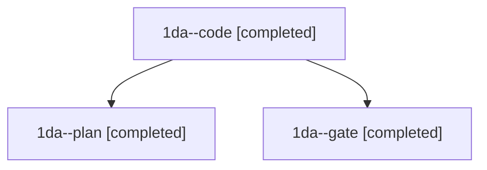

# Session: 1da

[Agent Hoods](../README.md) / [bbugyi200](../users/bbugyi200/README.md) / [athena](../users/bbugyi200/machines/athena/README.md) / [1da](../users/bbugyi200/machines/athena/hoods/1da/README.md) / 1da

Owner: `bbugyi200.athena` · Hood: `1da` · Members: 3

## Lineage

The diagram is an optional enhancement; the ordered table below contains the same lineage in accessible text.

| Role | Agent | State | Model / provider | Timing | Commits | Prompt | Chat |
|---|---|---|---|---|---:|---|---|
| code | 1da--code | completed | grok-4.6 / grok | 2026-11-17T12:25:56.649734+00:00 → 2026-11-17T13:02:05.979343+00:00 | 0 | [Prompt](../agents/bbugyi200.athena.1da--code/prompt.md) | [Chat](../agents/bbugyi200.athena.1da--code/chat.md) |
| plan | 1da--plan | completed | opus / claude | 2026-11-17T12:07:09.431748+00:00 → 2026-11-17T12:18:35.835112+00:00 | 0 | [Prompt](../agents/bbugyi200.athena.1da--plan/prompt.md) | [Chat](../agents/bbugyi200.athena.1da--plan/chat.md) |
| gate | 1da--gate | completed | opus / claude | 2026-11-17T12:24:10.353404+00:00 → 2026-11-17T12:25:27.984184+00:00 | 0 | — | [Chat](../agents/bbugyi200.athena.1da--gate/chat.md) |

## Neighbors

| Agent | Relation | State |
|---|---|---|
| [1da.f0](../agents/bbugyi200.athena.1da.f0/README.md) | descendant | active |
