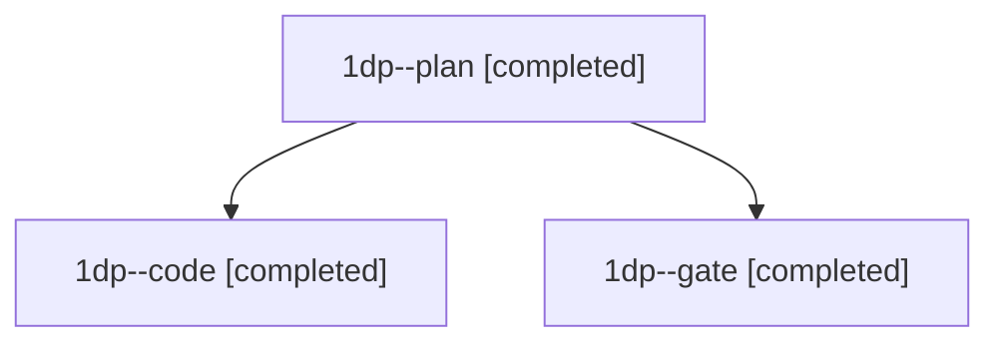

# Session: 1dp

[Agent Hoods](../README.md) / [bbugyi200](../users/bbugyi200/README.md) / [athena](../users/bbugyi200/machines/athena/README.md) / [1dp](../users/bbugyi200/machines/athena/hoods/1dp/README.md) / 1dp

Owner: `bbugyi200.athena` · Hood: `1dp` · Members: 3

## Lineage

The diagram is an optional enhancement; the ordered table below contains the same lineage in accessible text.

| Role | Agent | State | Model / provider | Timing | Commits | Prompt | Chat |
|---|---|---|---|---|---:|---|---|
| plan | 1dp--plan | completed | opus / claude | 2026-11-17T21:51:24.987036+00:00 → 2026-11-17T21:57:56.830682+00:00 | 0 | [Prompt](../agents/bbugyi200.athena.1dp--plan/prompt.md) | [Chat](../agents/bbugyi200.athena.1dp--plan/chat.md) |
| code | 1dp--code | completed | muse-spark-1.3-contributor / muse | 2026-11-17T22:04:35.538359+00:00 → 2026-11-17T22:16:39.370258+00:00 | 0 | [Prompt](../agents/bbugyi200.athena.1dp--code/prompt.md) | [Chat](../agents/bbugyi200.athena.1dp--code/chat.md) |
| gate | 1dp--gate | completed | opus / claude | 2026-11-17T21:57:48.303536+00:00 → 2026-11-17T22:00:55.323587+00:00 | 0 | — | [Chat](../agents/bbugyi200.athena.1dp--gate/chat.md) |
