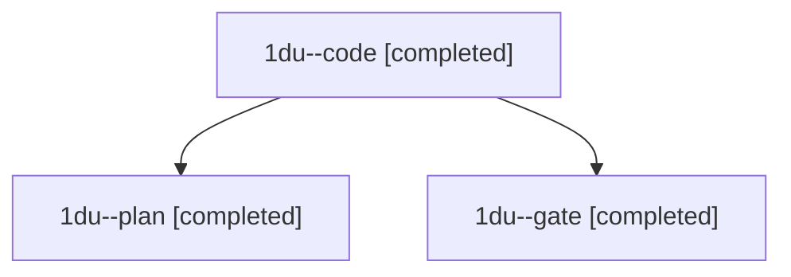

# Session: 1du

[Agent Hoods](../README.md) / [bbugyi200](../users/bbugyi200/README.md) / [athena](../users/bbugyi200/machines/athena/README.md) / [1du](../users/bbugyi200/machines/athena/hoods/1du/README.md) / 1du

Owner: `bbugyi200.athena` · Hood: `1du` · Members: 3

## Lineage

The diagram is an optional enhancement; the ordered table below contains the same lineage in accessible text.

| Role | Agent | State | Model / provider | Timing | Commits | Prompt | Chat |
|---|---|---|---|---|---:|---|---|
| code | 1du--code | completed | gpt-6-luna / codex | 2026-11-18T12:53:19.178817+00:00 → 2026-11-18T14:22:09.983152+00:00 | 0 | [Prompt](../agents/bbugyi200.athena.1du--code/prompt.md) | [Chat](../agents/bbugyi200.athena.1du--code/chat.md) |
| plan | 1du--plan | completed | opus / claude | 2026-11-18T12:17:29.925032+00:00 → 2026-11-18T12:33:50.779138+00:00 | 0 | [Prompt](../agents/bbugyi200.athena.1du--plan/prompt.md) | [Chat](../agents/bbugyi200.athena.1du--plan/chat.md) |
| gate | 1du--gate | completed | opus / claude | 2026-11-18T12:52:03.142598+00:00 → 2026-11-18T12:52:52.528985+00:00 | 0 | — | [Chat](../agents/bbugyi200.athena.1du--gate/chat.md) |
