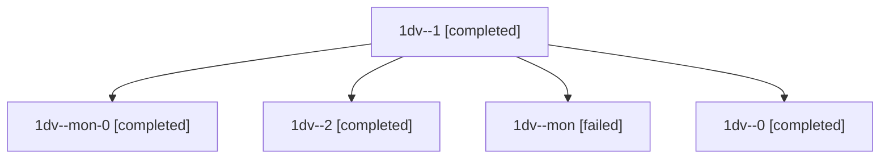

# Session: 1dv

[Agent Hoods](../README.md) / [bbugyi200](../users/bbugyi200/README.md) / [athena](../users/bbugyi200/machines/athena/README.md) / [1dv](../users/bbugyi200/machines/athena/hoods/1dv/README.md) / 1dv

Owner: `bbugyi200.athena` · Hood: `1dv` · Members: 5

## Lineage

The diagram is an optional enhancement; the ordered table below contains the same lineage in accessible text.

| Role | Agent | State | Model / provider | Timing | Commits | Prompt | Chat |
|---|---|---|---|---|---:|---|---|
| 1 | 1dv--1 | completed | gpt-6-astra / codex | 2026-11-18T13:23:03.557304+00:00 → 2026-11-18T13:26:23.258429+00:00 | 0 | [Prompt](../agents/bbugyi200.athena.1dv--1/prompt.md) | [Chat](../agents/bbugyi200.athena.1dv--1/chat.md) |
| mon-0 | 1dv--mon-0 | completed | gpt-6-astra / codex | 2026-11-18T13:25:54.400693+00:00 → 2026-11-18T14:02:48.749267+00:00 | 0 | — | [Chat](../agents/bbugyi200.athena.1dv--mon-0/chat.md) |
| 2 | 1dv--2 | completed | gpt-6-astra / codex | 2026-11-18T14:02:48.377942+00:00 → 2026-11-18T14:04:54.068771+00:00 | 0 | [Prompt](../agents/bbugyi200.athena.1dv--2/prompt.md) | [Chat](../agents/bbugyi200.athena.1dv--2/chat.md) |
| mon | 1dv--mon | failed | gpt-6-astra / codex | 2026-11-18T13:15:08.588310+00:00 → 2026-11-18T13:23:03.599734+00:00 | 0 | — | [Chat](../agents/bbugyi200.athena.1dv--mon/chat.md) |
| 0 | 1dv--0 | completed | gpt-6-astra / codex | 2026-11-18T13:06:34.681207+00:00 → 2026-11-18T13:15:39.420724+00:00 | 0 | [Prompt](../agents/bbugyi200.athena.1dv--0/prompt.md) | [Chat](../agents/bbugyi200.athena.1dv--0/chat.md) |
