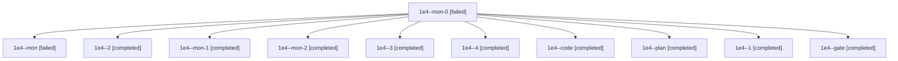

# Session: 1e4

[Agent Hoods](../README.md) / [bbugyi200](../users/bbugyi200/README.md) / [athena](../users/bbugyi200/machines/athena/README.md) / [1e4](../users/bbugyi200/machines/athena/hoods/1e4/README.md) / 1e4

Owner: `bbugyi200.athena` · Hood: `1e4` · Members: 11

## Lineage

The diagram is an optional enhancement; the ordered table below contains the same lineage in accessible text.

| Role | Agent | State | Model / provider | Timing | Commits | Prompt | Chat |
|---|---|---|---|---|---:|---|---|
| mon-0 | 1e4--mon-0 | failed | gpt-6-luna / codex | 2026-11-18T19:45:27.457817+00:00 → 2026-11-18T20:21:25.296024+00:00 | 0 | — | [Chat](../agents/bbugyi200.athena.1e4--mon-0/chat.md) |
| mon | 1e4--mon | failed | gpt-6-luna / codex | 2026-11-18T19:32:44.063938+00:00 → 2026-11-18T19:39:02.734748+00:00 | 0 | — | [Chat](../agents/bbugyi200.athena.1e4--mon/chat.md) |
| 2 | 1e4--2 | completed | gpt-6-luna / codex | 2026-11-18T20:21:25.153945+00:00 → 2026-11-18T20:28:07.825520+00:00 | 0 | [Prompt](../agents/bbugyi200.athena.1e4--2/prompt.md) | [Chat](../agents/bbugyi200.athena.1e4--2/chat.md) |
| mon-1 | 1e4--mon-1 | completed | gpt-6-luna / codex | 2026-11-18T20:27:12.170824+00:00 → 2026-11-18T21:01:51.785647+00:00 | 0 | — | [Chat](../agents/bbugyi200.athena.1e4--mon-1/chat.md) |
| mon-2 | 1e4--mon-2 | completed | gpt-6-luna / codex | 2026-11-18T21:07:59.555130+00:00 → 2026-11-18T21:11:01.279951+00:00 | 0 | — | [Chat](../agents/bbugyi200.athena.1e4--mon-2/chat.md) |
| 3 | 1e4--3 | completed | gpt-6-luna / codex | 2026-11-18T21:01:51.370502+00:00 → 2026-11-18T21:09:27.803543+00:00 | 0 | [Prompt](../agents/bbugyi200.athena.1e4--3/prompt.md) | [Chat](../agents/bbugyi200.athena.1e4--3/chat.md) |
| 4 | 1e4--4 | completed | gpt-6-luna / codex | 2026-11-18T21:11:01.260204+00:00 → 2026-11-18T21:13:35.237754+00:00 | 0 | [Prompt](../agents/bbugyi200.athena.1e4--4/prompt.md) | [Chat](../agents/bbugyi200.athena.1e4--4/chat.md) |
| code | 1e4--code | completed | gpt-6-luna / codex | 2026-11-18T19:08:02.528614+00:00 → 2026-11-18T19:33:55.401984+00:00 | 0 | [Prompt](../agents/bbugyi200.athena.1e4--code/prompt.md) | [Chat](../agents/bbugyi200.athena.1e4--code/chat.md) |
| plan | 1e4--plan | completed | opus / claude | 2026-11-18T18:53:52.453033+00:00 → 2026-11-18T19:06:24.752396+00:00 | 0 | [Prompt](../agents/bbugyi200.athena.1e4--plan/prompt.md) | [Chat](../agents/bbugyi200.athena.1e4--plan/chat.md) |
| 1 | 1e4--1 | completed | gpt-6-luna / codex | 2026-11-18T19:39:02.265869+00:00 → 2026-11-18T19:46:28.871285+00:00 | 0 | [Prompt](../agents/bbugyi200.athena.1e4--1/prompt.md) | [Chat](../agents/bbugyi200.athena.1e4--1/chat.md) |
| gate | 1e4--gate | completed | opus / claude | 2026-11-18T19:06:59.157931+00:00 → 2026-11-18T19:07:37.516706+00:00 | 0 | — | [Chat](../agents/bbugyi200.athena.1e4--gate/chat.md) |
