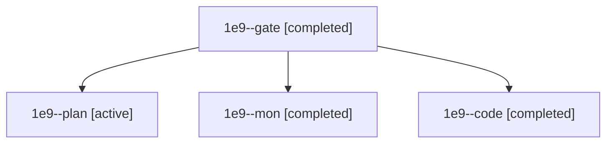

# Session: 1e9

[Agent Hoods](../README.md) / [bbugyi200](../users/bbugyi200/README.md) / [athena](../users/bbugyi200/machines/athena/README.md) / [1e9](../users/bbugyi200/machines/athena/hoods/1e9/README.md) / 1e9

Owner: `bbugyi200.athena` · Hood: `1e9` · Members: 4

## Lineage

The diagram is an optional enhancement; the ordered table below contains the same lineage in accessible text.

| Role | Agent | State | Model / provider | Timing | Commits | Prompt | Chat |
|---|---|---|---|---|---:|---|---|
| gate | 1e9--gate | completed | opus / claude | 2026-11-19T10:05:47.705423+00:00 → 2026-11-19T10:07:13.622929+00:00 | 0 | — | [Chat](../agents/bbugyi200.athena.1e9--gate/chat.md) |
| plan | 1e9--plan | active | opus / claude | 2026-11-19T09:52:10.994520+00:00 | 0 | [Prompt](../agents/bbugyi200.athena.1e9--plan/prompt.md) | [Chat](../agents/bbugyi200.athena.1e9--plan/chat.md) |
| mon | 1e9--mon | completed | grok-4.6 / grok | 2026-11-19T11:06:47.214360+00:00 → 2026-11-19T11:08:55.672977+00:00 | 0 | — | [Chat](../agents/bbugyi200.athena.1e9--mon/chat.md) |
| code | 1e9--code | completed | grok-4.6 / grok | 2026-11-19T10:07:38.973644+00:00 → 2026-11-19T11:08:42.934074+00:00 | 0 | [Prompt](../agents/bbugyi200.athena.1e9--code/prompt.md) | [Chat](../agents/bbugyi200.athena.1e9--code/chat.md) |
