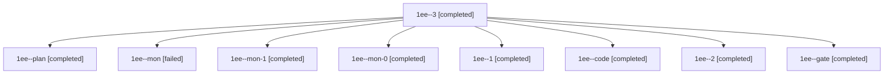

# Session: 1ee

[Agent Hoods](../README.md) / [bbugyi200](../users/bbugyi200/README.md) / [athena](../users/bbugyi200/machines/athena/README.md) / [1ee](../users/bbugyi200/machines/athena/hoods/1ee/README.md) / 1ee

Owner: `bbugyi200.athena` · Hood: `1ee` · Members: 9

## Lineage

The diagram is an optional enhancement; the ordered table below contains the same lineage in accessible text.

| Role | Agent | State | Model / provider | Timing | Commits | Prompt | Chat |
|---|---|---|---|---|---:|---|---|
| 3 | 1ee--3 | completed | gpt-6-luna / codex | 2026-11-19T16:40:45.560807+00:00 → 2026-11-19T16:42:33.982744+00:00 | 0 | [Prompt](../agents/bbugyi200.athena.1ee--3/prompt.md) | [Chat](../agents/bbugyi200.athena.1ee--3/chat.md) |
| plan | 1ee--plan | completed | opus / claude | 2026-11-19T13:10:18.385908+00:00 → 2026-11-19T13:19:14.667023+00:00 | 0 | [Prompt](../agents/bbugyi200.athena.1ee--plan/prompt.md) | [Chat](../agents/bbugyi200.athena.1ee--plan/chat.md) |
| mon | 1ee--mon | failed | gpt-6-luna / codex | 2026-11-19T14:45:49.366962+00:00 → 2026-11-19T15:18:11.378415+00:00 | 0 | — | [Chat](../agents/bbugyi200.athena.1ee--mon/chat.md) |
| mon-1 | 1ee--mon-1 | completed | gpt-6-luna / codex | 2026-11-19T16:03:15.972485+00:00 → 2026-11-19T16:40:45.848813+00:00 | 0 | — | [Chat](../agents/bbugyi200.athena.1ee--mon-1/chat.md) |
| mon-0 | 1ee--mon-0 | completed | gpt-6-luna / codex | 2026-11-19T15:25:16.462594+00:00 → 2026-11-19T15:49:58.571427+00:00 | 0 | — | [Chat](../agents/bbugyi200.athena.1ee--mon-0/chat.md) |
| 1 | 1ee--1 | completed | gpt-6-luna / codex | 2026-11-19T15:21:03.534301+00:00 → 2026-11-19T15:48:51.304347+00:00 | 0 | [Prompt](../agents/bbugyi200.athena.1ee--1/prompt.md) | [Chat](../agents/bbugyi200.athena.1ee--1/chat.md) |
| code | 1ee--code | completed | gpt-6-luna / codex | 2026-11-19T14:13:23.466048+00:00 → 2026-11-19T14:47:31.647648+00:00 | 0 | [Prompt](../agents/bbugyi200.athena.1ee--code/prompt.md) | [Chat](../agents/bbugyi200.athena.1ee--code/chat.md) |
| 2 | 1ee--2 | completed | gpt-6-luna / codex | 2026-11-19T15:49:58.076429+00:00 → 2026-11-19T16:04:21.814505+00:00 | 0 | [Prompt](../agents/bbugyi200.athena.1ee--2/prompt.md) | [Chat](../agents/bbugyi200.athena.1ee--2/chat.md) |
| gate | 1ee--gate | completed | opus / claude | 2026-11-19T14:12:33.297784+00:00 → 2026-11-19T14:12:55.830066+00:00 | 0 | — | [Chat](../agents/bbugyi200.athena.1ee--gate/chat.md) |
