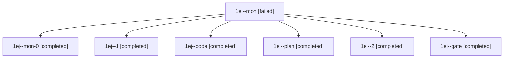

# Session: 1ej

[Agent Hoods](../README.md) / [bbugyi200](../users/bbugyi200/README.md) / [athena](../users/bbugyi200/machines/athena/README.md) / [1ej](../users/bbugyi200/machines/athena/hoods/1ej/README.md) / 1ej

Owner: `bbugyi200.athena` · Hood: `1ej` · Members: 7

## Lineage

The diagram is an optional enhancement; the ordered table below contains the same lineage in accessible text.

| Role | Agent | State | Model / provider | Timing | Commits | Prompt | Chat |
|---|---|---|---|---|---:|---|---|
| mon | 1ej--mon | failed | gpt-6-luna / codex | 2026-11-20T14:16:34.389071+00:00 → 2026-11-20T14:18:15.826583+00:00 | 0 | — | [Chat](../agents/bbugyi200.athena.1ej--mon/chat.md) |
| mon-0 | 1ej--mon-0 | completed | gpt-6-luna / codex | 2026-11-20T14:25:44.174883+00:00 → 2026-11-20T14:41:34.154998+00:00 | 0 | — | [Chat](../agents/bbugyi200.athena.1ej--mon-0/chat.md) |
| 1 | 1ej--1 | completed | gpt-6-luna / codex | 2026-11-20T14:18:15.735018+00:00 → 2026-11-20T14:26:21.604832+00:00 | 0 | [Prompt](../agents/bbugyi200.athena.1ej--1/prompt.md) | [Chat](../agents/bbugyi200.athena.1ej--1/chat.md) |
| code | 1ej--code | completed | gpt-6-luna / codex | 2026-11-20T14:05:53.926541+00:00 → 2026-11-20T14:17:14.349446+00:00 | 0 | [Prompt](../agents/bbugyi200.athena.1ej--code/prompt.md) | [Chat](../agents/bbugyi200.athena.1ej--code/chat.md) |
| plan | 1ej--plan | completed | opus / claude | 2026-11-20T13:57:46.298535+00:00 → 2026-11-20T14:04:27.735206+00:00 | 0 | [Prompt](../agents/bbugyi200.athena.1ej--plan/prompt.md) | [Chat](../agents/bbugyi200.athena.1ej--plan/chat.md) |
| 2 | 1ej--2 | completed | gpt-6-luna / codex | 2026-11-20T14:59:21.872610+00:00 → 2026-11-20T15:03:59.925281+00:00 | 0 | [Prompt](../agents/bbugyi200.athena.1ej--2/prompt.md) | [Chat](../agents/bbugyi200.athena.1ej--2/chat.md) |
| gate | 1ej--gate | completed | opus / claude | 2026-11-20T14:04:51.995450+00:00 → 2026-11-20T14:05:29.399689+00:00 | 0 | — | [Chat](../agents/bbugyi200.athena.1ej--gate/chat.md) |
