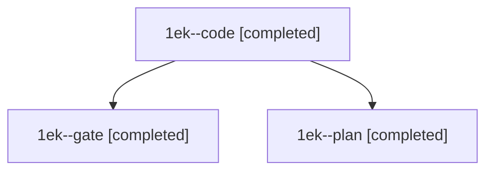

# Session: 1ek

[Agent Hoods](../README.md) / [bbugyi200](../users/bbugyi200/README.md) / [athena](../users/bbugyi200/machines/athena/README.md) / [1ek](../users/bbugyi200/machines/athena/hoods/1ek/README.md) / 1ek

Owner: `bbugyi200.athena` · Hood: `1ek` · Members: 3

## Lineage

The diagram is an optional enhancement; the ordered table below contains the same lineage in accessible text.

| Role | Agent | State | Model / provider | Timing | Commits | Prompt | Chat |
|---|---|---|---|---|---:|---|---|
| code | 1ek--code | completed | opus / claude | 2026-11-20T14:17:15.041087+00:00 → 2026-11-20T14:34:40.859878+00:00 | [1](../agents/bbugyi200.athena.1ek--code/README.md#commits) | [Prompt](../agents/bbugyi200.athena.1ek--code/prompt.md) | [Chat](../agents/bbugyi200.athena.1ek--code/chat.md) |
| gate | 1ek--gate | completed | opus / claude | 2026-11-20T14:16:14.559951+00:00 → 2026-11-20T14:16:52.386503+00:00 | 0 | — | [Chat](../agents/bbugyi200.athena.1ek--gate/chat.md) |
| plan | 1ek--plan | completed | opus / claude | 2026-11-20T14:06:35.623249+00:00 → 2026-11-20T14:15:22.470786+00:00 | 0 | [Prompt](../agents/bbugyi200.athena.1ek--plan/prompt.md) | [Chat](../agents/bbugyi200.athena.1ek--plan/chat.md) |

## Commits

| Role | Repo | Commit | Subject | Committed |
|---|---|---|---|---|
| code | bob-cli | [`ab34144`](https://github.com/bobs-org/bob-cli/commit/ab34144686dedf2a8388a7b44ee110296c28e9f9) | feat(install): skip the Mac Capture rebuild when its app is current | 2026-11-20 09:34:22 EST |
