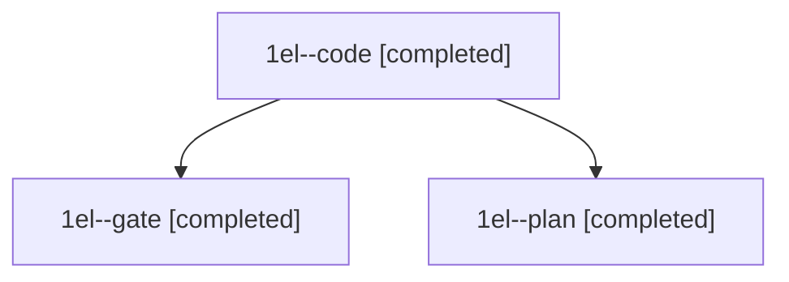

# Session: 1el

[Agent Hoods](../README.md) / [bbugyi200](../users/bbugyi200/README.md) / [athena](../users/bbugyi200/machines/athena/README.md) / [1el](../users/bbugyi200/machines/athena/hoods/1el/README.md) / 1el

Owner: `bbugyi200.athena` · Hood: `1el` · Members: 3

## Lineage

The diagram is an optional enhancement; the ordered table below contains the same lineage in accessible text.

| Role | Agent | State | Model / provider | Timing | Commits | Prompt | Chat |
|---|---|---|---|---|---:|---|---|
| code | 1el--code | completed | opus / claude | 2026-11-20T14:46:28.844886+00:00 → 2026-11-20T15:43:37.542409+00:00 | [1](../agents/bbugyi200.athena.1el--code/README.md#commits) | [Prompt](../agents/bbugyi200.athena.1el--code/prompt.md) | [Chat](../agents/bbugyi200.athena.1el--code/chat.md) |
| gate | 1el--gate | completed | opus / claude | 2026-11-20T14:20:54.217126+00:00 → 2026-11-20T14:31:59.549354+00:00 | 0 | — | [Chat](../agents/bbugyi200.athena.1el--gate/chat.md) |
| plan | 1el--plan | completed | opus / claude | 2026-11-20T14:10:27.099292+00:00 → 2026-11-20T14:21:05.368094+00:00 | 0 | [Prompt](../agents/bbugyi200.athena.1el--plan/prompt.md) | [Chat](../agents/bbugyi200.athena.1el--plan/chat.md) |

## Commits

| Role | Repo | Commit | Subject | Committed |
|---|---|---|---|---|
| code | bob-cli | [`1c5fd0f`](https://github.com/bobs-org/bob-cli/commit/1c5fd0fc12f01a61bd8bb9c4e55bd9788df3f44e) | feat(capture): rank completed task history by match score | 2026-11-20 10:42:38 EST |
