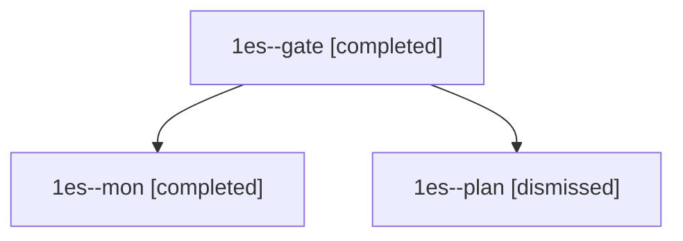

# Session: 1es

[Agent Hoods](../README.md) / [bbugyi200](../users/bbugyi200/README.md) / [athena](../users/bbugyi200/machines/athena/README.md) / [1es](../users/bbugyi200/machines/athena/hoods/1es/README.md) / 1es

Owner: `bbugyi200.athena` · Hood: `1es` · Members: 3

## Lineage

The diagram is an optional enhancement; the ordered table below contains the same lineage in accessible text.

| Role | Agent | State | Model / provider | Timing | Commits | Prompt | Chat |
|---|---|---|---|---|---:|---|---|
| gate | 1es--gate | completed | opus / claude | 2026-11-21T12:41:18.185641+00:00 → 2026-11-21T12:41:30.251447+00:00 | 0 | — | [Chat](../agents/bbugyi200.athena.1es--gate/chat.md) |
| mon | 1es--mon | completed | opus / claude | 2026-11-21T12:41:29.334506+00:00 → 2026-11-21T12:44:29.158610+00:00 | 0 | — | [Chat](../agents/bbugyi200.athena.1es--mon/chat.md) |
| plan | 1es--plan | dismissed | opus / claude | 2026-11-21T07:21:58.117880 → 2026-11-21T07:41:36.966772 | 0 | [Prompt](../agents/bbugyi200.athena.1es--plan/prompt.md) | [Chat](../agents/bbugyi200.athena.1es--plan/chat.md) |
