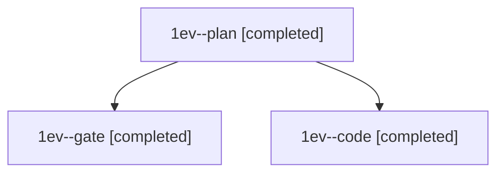

# Session: 1ev

[Agent Hoods](../README.md) / [bbugyi200](../users/bbugyi200/README.md) / [athena](../users/bbugyi200/machines/athena/README.md) / [1ev](../users/bbugyi200/machines/athena/hoods/1ev/README.md) / 1ev

Owner: `bbugyi200.athena` · Hood: `1ev` · Members: 3

## Lineage

The diagram is an optional enhancement; the ordered table below contains the same lineage in accessible text.

| Role | Agent | State | Model / provider | Timing | Commits | Prompt | Chat |
|---|---|---|---|---|---:|---|---|
| plan | 1ev--plan | completed | opus / claude | 2026-11-21T15:03:22.273061+00:00 → 2026-11-21T15:08:02.333290+00:00 | 0 | [Prompt](../agents/bbugyi200.athena.1ev--plan/prompt.md) | [Chat](../agents/bbugyi200.athena.1ev--plan/chat.md) |
| gate | 1ev--gate | completed | opus / claude | 2026-11-21T15:11:26.977894+00:00 → 2026-11-21T15:12:35.568864+00:00 | 0 | — | [Chat](../agents/bbugyi200.athena.1ev--gate/chat.md) |
| code | 1ev--code | completed | muse-spark-1.3-contributor / muse | 2026-11-21T15:12:59.144312+00:00 → 2026-11-21T15:29:31.493028+00:00 | 0 | [Prompt](../agents/bbugyi200.athena.1ev--code/prompt.md) | [Chat](../agents/bbugyi200.athena.1ev--code/chat.md) |
