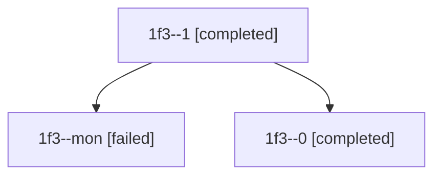

# Session: 1f3

[Agent Hoods](../README.md) / [bbugyi200](../users/bbugyi200/README.md) / [athena](../users/bbugyi200/machines/athena/README.md) / [1f3](../users/bbugyi200/machines/athena/hoods/1f3/README.md) / 1f3

Owner: `bbugyi200.athena` · Hood: `1f3` · Members: 3

## Lineage

The diagram is an optional enhancement; the ordered table below contains the same lineage in accessible text.

| Role | Agent | State | Model / provider | Timing | Commits | Prompt | Chat |
|---|---|---|---|---|---:|---|---|
| 1 | 1f3--1 | completed | gpt-6-astra / codex | 2026-11-22T12:04:41.561976+00:00 → 2026-11-22T12:19:49.490639+00:00 | [1](../agents/bbugyi200.athena.1f3--1/README.md#commits) | [Prompt](../agents/bbugyi200.athena.1f3--1/prompt.md) | [Chat](../agents/bbugyi200.athena.1f3--1/chat.md) |
| mon | 1f3--mon | failed | gpt-6-astra / codex | 2026-11-22T11:58:10.922522+00:00 → 2026-11-22T12:04:41.934338+00:00 | 0 | — | [Chat](../agents/bbugyi200.athena.1f3--mon/chat.md) |
| 0 | 1f3--0 | completed | gpt-6-astra / codex | 2026-11-22T11:49:59.951946+00:00 → 2026-11-22T11:58:45.401353+00:00 | 0 | [Prompt](../agents/bbugyi200.athena.1f3--0/prompt.md) | [Chat](../agents/bbugyi200.athena.1f3--0/chat.md) |

## Commits

| Role | Repo | Commit | Subject | Committed |
|---|---|---|---|---|
| 1 | bob-cli | [`5dfd0da`](https://github.com/bobs-org/bob-cli/commit/5dfd0dac7be1483eac58d73a5cbd2a116a63ea5e) | fix(albums): heal Obsidian-rewritten record walk arms | 2026-11-22 07:19:28 EST |
