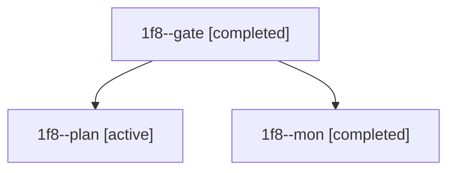

# Session: 1f8

[Agent Hoods](../README.md) / [bbugyi200](../users/bbugyi200/README.md) / [athena](../users/bbugyi200/machines/athena/README.md) / [1f8](../users/bbugyi200/machines/athena/hoods/1f8/README.md) / 1f8

Owner: `bbugyi200.athena` · Hood: `1f8` · Members: 3

## Lineage

The diagram is an optional enhancement; the ordered table below contains the same lineage in accessible text.

| Role | Agent | State | Model / provider | Timing | Commits | Prompt | Chat |
|---|---|---|---|---|---:|---|---|
| gate | 1f8--gate | completed | opus / claude | 2026-11-23T08:54:01.987983+00:00 → 2026-11-23T08:54:13.729635+00:00 | 0 | — | [Chat](../agents/bbugyi200.athena.1f8--gate/chat.md) |
| plan | 1f8--plan | active | opus / claude | 2026-11-23T08:32:20.212488+00:00 → 2026-11-23T08:54:20.275133+00:00 | 0 | [Prompt](../agents/bbugyi200.athena.1f8--plan/prompt.md) | [Chat](../agents/bbugyi200.athena.1f8--plan/chat.md) |
| mon | 1f8--mon | completed | opus / claude | 2026-11-23T08:54:12.738471+00:00 → 2026-11-23T08:57:00.150702+00:00 | 0 | — | [Chat](../agents/bbugyi200.athena.1f8--mon/chat.md) |
