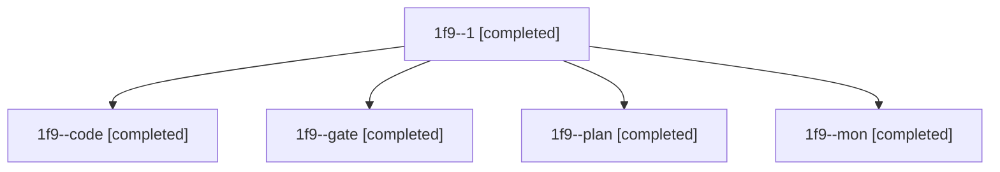

# Session: 1f9

[Agent Hoods](../README.md) / [bbugyi200](../users/bbugyi200/README.md) / [athena](../users/bbugyi200/machines/athena/README.md) / [1f9](../users/bbugyi200/machines/athena/hoods/1f9/README.md) / 1f9

Owner: `bbugyi200.athena` · Hood: `1f9` · Members: 5

## Lineage



The diagram is an optional enhancement; the ordered table below contains the same lineage in accessible text.

| Role | Agent | State | Model / provider | Timing | Commits | Prompt | Chat |
|---|---|---|---|---|---:|---|---|
| <a id="member-1"></a>1 | 1f9--1 | completed | gpt-6-luna / codex | 2026-11-22T23:15:32.715339+00:00 → 2026-11-22T23:16:57.923728+00:00 | 0 | [Prompt](../agents/bbugyi200.athena.1f9--1/prompt.md) | — |
| <a id="member-code"></a>code | 1f9--code | completed | gpt-6-luna / codex | 2026-11-22T22:39:00.967011+00:00 → 2026-11-22T23:14:05.508289+00:00 | 0 | [Prompt](../agents/bbugyi200.athena.1f9--code/prompt.md) | [Chat](../agents/bbugyi200.athena.1f9--code/chat.md) |
| <a id="member-gate"></a>gate | 1f9--gate | completed | opus / claude | 2026-11-22T22:37:57.005003+00:00 → 2026-11-22T22:38:39.418614+00:00 | 0 | — | [Chat](../agents/bbugyi200.athena.1f9--gate/chat.md) |
| <a id="member-plan"></a>plan | 1f9--plan | completed | opus / claude | 2026-11-22T22:26:00.760097+00:00 → 2026-11-22T22:35:26.734170+00:00 | 0 | [Prompt](../agents/bbugyi200.athena.1f9--plan/prompt.md) | [Chat](../agents/bbugyi200.athena.1f9--plan/chat.md) |
| <a id="member-mon"></a>mon | 1f9--mon | completed | gpt-6-luna / codex | 2026-11-22T23:11:57.656373+00:00 → 2026-11-22T23:15:32.757736+00:00 | 0 | — | [Chat](../agents/bbugyi200.athena.1f9--mon/chat.md) |

## Variables

| Role | Variable | Value |
|---|---|---|
| code | `artifacts` | \[{kind: markdown, label: bob-plugins full-suite timing failures and serial passes, path: /home/bryan/.sase/artifacts/agents/gh\_bobs-org\_\_bob-cli/20261122173839/bob-plugins-perf-flake-evidence-afe4c91… |

#### artifacts

**Role:** `code`

```yaml
- kind: markdown
  label: bob-plugins full-suite timing failures and serial passes
  path: /home/bryan/.sase/artifacts/agents/gh_bobs-org__bob-cli/20261122173839/bob-plugins-perf-flake-evidence-afe4c91c49b2.md
  ref: file:explicit:77d4ba946d61715fbf674abb
  source_path: /tmp/bob-plugins-perf-flake-evidence.md
```

Values are truncated for display; see each member's agent meta.json for the full values.
