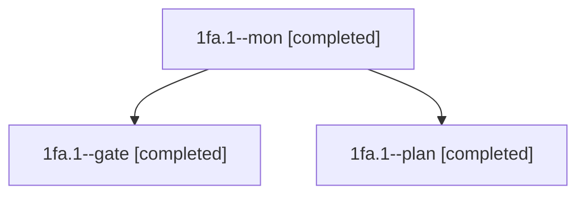

# Session: 1fa.1

[Agent Hoods](../README.md) / [bbugyi200](../users/bbugyi200/README.md) / [athena](../users/bbugyi200/machines/athena/README.md) / [1fa](../users/bbugyi200/machines/athena/hoods/1fa/README.md) / 1fa.1

Owner: `bbugyi200.athena` · Hood: `1fa` · Members: 3

## Lineage

The diagram is an optional enhancement; the ordered table below contains the same lineage in accessible text.

| Role | Agent | State | Model / provider | Timing | Commits | Prompt | Chat |
|---|---|---|---|---|---:|---|---|
| mon | 1fa.1--mon | completed | opus / claude | 2026-11-22T23:00:37.695728+00:00 → 2026-11-22T23:03:39.726169+00:00 | 0 | — | [Chat](../agents/bbugyi200.athena.1fa.1--mon/chat.md) |
| gate | 1fa.1--gate | completed | opus / claude | 2026-11-22T23:00:24.741097+00:00 → 2026-11-22T23:00:43.343442+00:00 | 0 | — | [Chat](../agents/bbugyi200.athena.1fa.1--gate/chat.md) |
| plan | 1fa.1--plan | completed | opus / claude | 2026-11-22T22:39:47.264871+00:00 → 2026-11-22T22:55:58.398251+00:00 | 0 | [Prompt](../agents/bbugyi200.athena.1fa.1--plan/prompt.md) | [Chat](../agents/bbugyi200.athena.1fa.1--plan/chat.md) |

## Neighbors

| Agent | Relation | State |
|---|---|---|
| [1fa.2](bbugyi200.athena.1fa.2.md) (session · 5) | 1fa hood | completed 5 |
