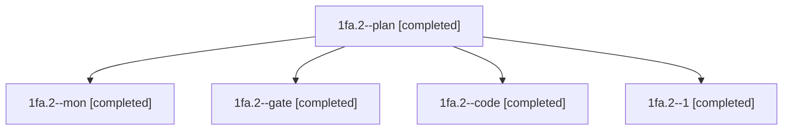

# Session: 1fa.2

[Agent Hoods](../README.md) / [bbugyi200](../users/bbugyi200/README.md) / [athena](../users/bbugyi200/machines/athena/README.md) / [1fa](../users/bbugyi200/machines/athena/hoods/1fa/README.md) / 1fa.2

Owner: `bbugyi200.athena` · Hood: `1fa` · Members: 5

## Lineage

The diagram is an optional enhancement; the ordered table below contains the same lineage in accessible text.

| Role | Agent | State | Model / provider | Timing | Commits | Prompt | Chat |
|---|---|---|---|---|---:|---|---|
| plan | 1fa.2--plan | completed | opus / claude | 2026-11-22T22:39:50.260935+00:00 → 2026-11-22T23:00:38.606790+00:00 | 0 | [Prompt](../agents/bbugyi200.athena.1fa.2--plan/prompt.md) | [Chat](../agents/bbugyi200.athena.1fa.2--plan/chat.md) |
| mon | 1fa.2--mon | completed | grok-4.6 / grok | 2026-11-22T23:26:47.485274+00:00 → 2026-11-22T23:35:28.642072+00:00 | 0 | — | [Chat](../agents/bbugyi200.athena.1fa.2--mon/chat.md) |
| gate | 1fa.2--gate | completed | opus / claude | 2026-11-22T23:01:13.154651+00:00 → 2026-11-22T23:01:37.393708+00:00 | 0 | — | [Chat](../agents/bbugyi200.athena.1fa.2--gate/chat.md) |
| code | 1fa.2--code | completed | grok-4.6 / grok | 2026-11-22T23:02:00.925262+00:00 → 2026-11-22T23:27:56.240427+00:00 | 0 | [Prompt](../agents/bbugyi200.athena.1fa.2--code/prompt.md) | [Chat](../agents/bbugyi200.athena.1fa.2--code/chat.md) |
| 1 | 1fa.2--1 | completed | grok-4.6 / grok | 2026-11-22T23:35:28.165413+00:00 → 2026-11-22T23:53:30.217923+00:00 | [1](../agents/bbugyi200.athena.1fa.2--1/README.md#commits) | [Prompt](../agents/bbugyi200.athena.1fa.2--1/prompt.md) | [Chat](../agents/bbugyi200.athena.1fa.2--1/chat.md) |

## Commits

| Role | Repo | Commit | Subject | Committed |
|---|---|---|---|---|
| 1 | bob-cli | [`8c019eb`](https://github.com/bobs-org/bob-cli/commit/8c019eb490077bab7d44bc4b3b62b83dd9a88dc5) | fix(gmail): collapse HTML whitespace like a browser | 2026-11-22 18:53:18 EST |

## Neighbors

| Agent | Relation | State |
|---|---|---|
| [1fa.1](bbugyi200.athena.1fa.1.md) (session · 3) | 1fa hood | completed 3 |
