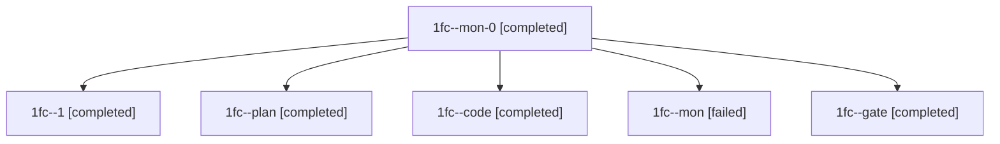

# Session: 1fc

[Agent Hoods](../README.md) / [bbugyi200](../users/bbugyi200/README.md) / [athena](../users/bbugyi200/machines/athena/README.md) / [1fc](../users/bbugyi200/machines/athena/hoods/1fc/README.md) / 1fc

Owner: `bbugyi200.athena` · Hood: `1fc` · Members: 6

## Lineage

The diagram is an optional enhancement; the ordered table below contains the same lineage in accessible text.

| Role | Agent | State | Model / provider | Timing | Commits | Prompt | Chat |
|---|---|---|---|---|---:|---|---|
| mon-0 | 1fc--mon-0 | completed | grok-4.6 / grok | 2026-11-23T00:12:40.340448+00:00 → 2026-11-23T00:26:15.609180+00:00 | 0 | — | [Chat](../agents/bbugyi200.athena.1fc--mon-0/chat.md) |
| 1 | 1fc--1 | completed | grok-4.6 / grok | 2026-11-23T00:26:15.293569+00:00 → 2026-11-23T00:44:09.323023+00:00 | [1](../agents/bbugyi200.athena.1fc--1/README.md#commits) | [Prompt](../agents/bbugyi200.athena.1fc--1/prompt.md) | [Chat](../agents/bbugyi200.athena.1fc--1/chat.md) |
| plan | 1fc--plan | completed | opus / claude | 2026-11-22T23:12:28.584318+00:00 → 2026-11-22T23:21:52.153032+00:00 | 0 | [Prompt](../agents/bbugyi200.athena.1fc--plan/prompt.md) | [Chat](../agents/bbugyi200.athena.1fc--plan/chat.md) |
| code | 1fc--code | completed | grok-4.6 / grok | 2026-11-22T23:23:12.860823+00:00 → 2026-11-23T00:14:56.066454+00:00 | 0 | [Prompt](../agents/bbugyi200.athena.1fc--code/prompt.md) | [Chat](../agents/bbugyi200.athena.1fc--code/chat.md) |
| mon | 1fc--mon | failed | grok-4.6 / grok | 2026-11-23T00:01:03.101563+00:00 → 2026-11-23T00:11:28.792733+00:00 | 0 | — | — |
| gate | 1fc--gate | completed | opus / claude | 2026-11-22T23:21:56.537895+00:00 → 2026-11-22T23:22:48.953095+00:00 | 0 | — | [Chat](../agents/bbugyi200.athena.1fc--gate/chat.md) |

## Commits

| Role | Repo | Commit | Subject | Committed |
|---|---|---|---|---|
| 1 | bob-cli | [`7f104e5`](https://github.com/bobs-org/bob-cli/commit/7f104e52f4672f78b5c0af6ed6ee25dc965c0359) | fix(capture): keep mentions as history on Pomodoro close | 2026-11-22 19:43:42 EST |
