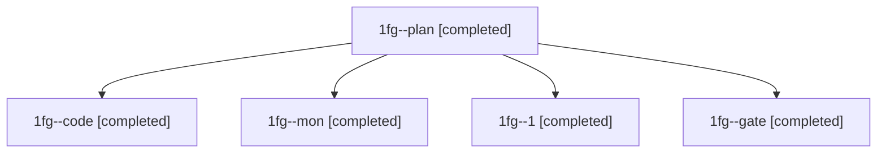

# Session: 1fg

[Agent Hoods](../README.md) / [bbugyi200](../users/bbugyi200/README.md) / [athena](../users/bbugyi200/machines/athena/README.md) / [1fg](../users/bbugyi200/machines/athena/hoods/1fg/README.md) / 1fg

Owner: `bbugyi200.athena` · Hood: `1fg` · Members: 5

## Lineage

The diagram is an optional enhancement; the ordered table below contains the same lineage in accessible text.

| Role | Agent | State | Model / provider | Timing | Commits | Prompt | Chat |
|---|---|---|---|---|---:|---|---|
| plan | 1fg--plan | completed | opus / claude | 2026-11-23T12:49:24.206794+00:00 → 2026-11-23T12:57:43.771955+00:00 | 0 | [Prompt](../agents/bbugyi200.athena.1fg--plan/prompt.md) | [Chat](../agents/bbugyi200.athena.1fg--plan/chat.md) |
| code | 1fg--code | completed | muse-spark-1.3-contributor / muse | 2026-11-23T13:01:55.219236+00:00 → 2026-11-23T13:46:01.599593+00:00 | 0 | [Prompt](../agents/bbugyi200.athena.1fg--code/prompt.md) | [Chat](../agents/bbugyi200.athena.1fg--code/chat.md) |
| mon | 1fg--mon | completed | muse-spark-1.3-contributor / muse | 2026-11-23T13:44:45.037881+00:00 → 2026-11-23T13:47:13.100382+00:00 | 0 | — | [Chat](../agents/bbugyi200.athena.1fg--mon/chat.md) |
| 1 | 1fg--1 | completed | muse-spark-1.3-contributor / muse | 2026-11-23T13:47:12.809975+00:00 → 2026-11-23T13:48:18.673181+00:00 | [1](../agents/bbugyi200.athena.1fg--1/README.md#commits) | [Prompt](../agents/bbugyi200.athena.1fg--1/prompt.md) | [Chat](../agents/bbugyi200.athena.1fg--1/chat.md) |
| gate | 1fg--gate | completed | opus / claude | 2026-11-23T13:00:40.837501+00:00 → 2026-11-23T13:01:03.305156+00:00 | 0 | — | [Chat](../agents/bbugyi200.athena.1fg--gate/chat.md) |

## Commits

| Role | Repo | Commit | Subject | Committed |
|---|---|---|---|---|
| 1 | bob-cli | [`e6a6326`](https://github.com/bobs-org/bob-cli/commit/e6a6326a89be4117aeaf2d194790e36bc513757f) | feat(tick): retry offline network blips on next tick | 2026-11-23 08:48:00 EST |
