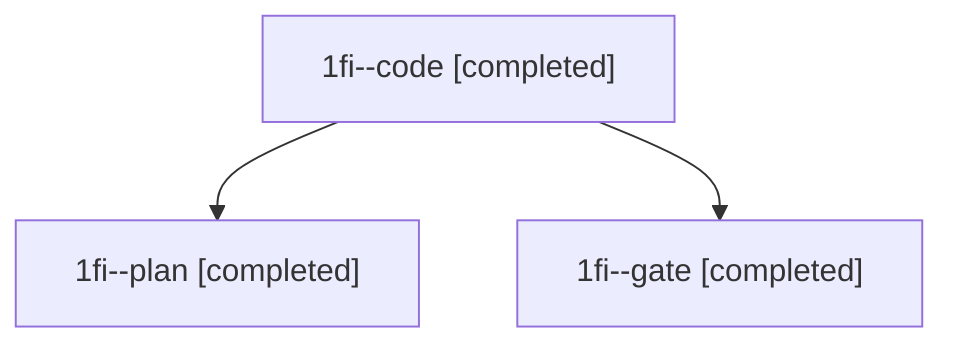

# Session: 1fi

[Agent Hoods](../README.md) / [bbugyi200](../users/bbugyi200/README.md) / [athena](../users/bbugyi200/machines/athena/README.md) / [1fi](../users/bbugyi200/machines/athena/hoods/1fi/README.md) / 1fi

Owner: `bbugyi200.athena` · Hood: `1fi` · Members: 3

## Lineage

The diagram is an optional enhancement; the ordered table below contains the same lineage in accessible text.

| Role | Agent | State | Model / provider | Timing | Commits | Prompt | Chat |
|---|---|---|---|---|---:|---|---|
| code | 1fi--code | completed | muse-spark-1.3-contributor / muse | 2026-11-23T13:17:15.098198+00:00 → 2026-11-23T13:34:20.477256+00:00 | [1](../agents/bbugyi200.athena.1fi--code/README.md#commits) | [Prompt](../agents/bbugyi200.athena.1fi--code/prompt.md) | [Chat](../agents/bbugyi200.athena.1fi--code/chat.md) |
| plan | 1fi--plan | completed | opus / claude | 2026-11-23T13:02:21.299551+00:00 → 2026-11-23T13:12:20.144084+00:00 | 0 | [Prompt](../agents/bbugyi200.athena.1fi--plan/prompt.md) | [Chat](../agents/bbugyi200.athena.1fi--plan/chat.md) |
| gate | 1fi--gate | completed | opus / claude | 2026-11-23T13:12:56.256812+00:00 → 2026-11-23T13:13:50.763068+00:00 | 0 | — | [Chat](../agents/bbugyi200.athena.1fi--gate/chat.md) |

## Commits

| Role | Repo | Commit | Subject | Committed |
|---|---|---|---|---|
| code | bob-cli | [`b228b1b`](https://github.com/bobs-org/bob-cli/commit/b228b1b8797c087943dde04c6a5ee967baea1701) | docs(task-deps): successor close survives concurrent reconcile (SV26) | 2026-11-23 08:33:53 EST |
