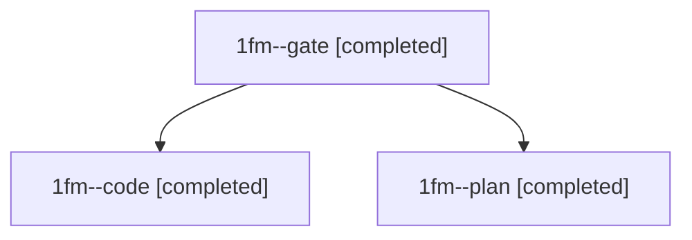

# Session: 1fm

[Agent Hoods](../README.md) / [bbugyi200](../users/bbugyi200/README.md) / [athena](../users/bbugyi200/machines/athena/README.md) / [1fm](../users/bbugyi200/machines/athena/hoods/1fm/README.md) / 1fm

Owner: `bbugyi200.athena` · Hood: `1fm` · Members: 3

## Lineage

The diagram is an optional enhancement; the ordered table below contains the same lineage in accessible text.

| Role | Agent | State | Model / provider | Timing | Commits | Prompt | Chat |
|---|---|---|---|---|---:|---|---|
| gate | 1fm--gate | completed | opus / claude | 2026-11-23T16:37:39.942650+00:00 → 2026-11-23T16:38:19.737728+00:00 | 0 | — | [Chat](../agents/bbugyi200.athena.1fm--gate/chat.md) |
| code | 1fm--code | completed | muse-spark-1.3-contributor / muse | 2026-11-23T16:38:42.731006+00:00 → 2026-11-23T17:24:54.352120+00:00 | 0 | [Prompt](../agents/bbugyi200.athena.1fm--code/prompt.md) | [Chat](../agents/bbugyi200.athena.1fm--code/chat.md) |
| plan | 1fm--plan | completed | opus / claude | 2026-11-23T16:22:23.798498+00:00 → 2026-11-23T16:31:04.992444+00:00 | 0 | [Prompt](../agents/bbugyi200.athena.1fm--plan/prompt.md) | [Chat](../agents/bbugyi200.athena.1fm--plan/chat.md) |
