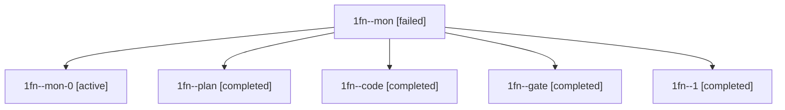

# Session: 1fn

[Agent Hoods](../README.md) / [bbugyi200](../users/bbugyi200/README.md) / [athena](../users/bbugyi200/machines/athena/README.md) / [1fn](../users/bbugyi200/machines/athena/hoods/1fn/README.md) / 1fn

Owner: `bbugyi200.athena` · Hood: `1fn` · Members: 6

## Lineage

The diagram is an optional enhancement; the ordered table below contains the same lineage in accessible text.

| Role | Agent | State | Model / provider | Timing | Commits | Prompt | Chat |
|---|---|---|---|---|---:|---|---|
| mon | 1fn--mon | failed | gpt-6-luna / codex | 2026-11-23T18:50:54.913219+00:00 → 2026-11-23T18:54:37.866003+00:00 | 0 | — | [Chat](../agents/bbugyi200.athena.1fn--mon/chat.md) |
| mon-0 | 1fn--mon-0 | active | gpt-6-luna / codex | 2026-11-23T19:00:35.787337+00:00 | 0 | — | — |
| plan | 1fn--plan | completed | opus / claude | 2026-11-23T18:17:34.280701+00:00 → 2026-11-23T18:27:51.224849+00:00 | 0 | [Prompt](../agents/bbugyi200.athena.1fn--plan/prompt.md) | [Chat](../agents/bbugyi200.athena.1fn--plan/chat.md) |
| code | 1fn--code | completed | gpt-6-luna / codex | 2026-11-23T18:29:55.104576+00:00 → 2026-11-23T18:52:44.001340+00:00 | [1](../agents/bbugyi200.athena.1fn--code/README.md#commits) | [Prompt](../agents/bbugyi200.athena.1fn--code/prompt.md) | [Chat](../agents/bbugyi200.athena.1fn--code/chat.md) |
| gate | 1fn--gate | completed | opus / claude | 2026-11-23T18:28:58.448326+00:00 → 2026-11-23T18:29:33.841696+00:00 | 0 | — | [Chat](../agents/bbugyi200.athena.1fn--gate/chat.md) |
| 1 | 1fn--1 | completed | gpt-6-luna / codex | 2026-11-23T18:54:37.530948+00:00 → 2026-11-23T19:01:53.100574+00:00 | 0 | [Prompt](../agents/bbugyi200.athena.1fn--1/prompt.md) | [Chat](../agents/bbugyi200.athena.1fn--1/chat.md) |

## Commits

| Role | Repo | Commit | Subject | Committed |
|---|---|---|---|---|
| code | bob-cli | [`6d8d588`](https://github.com/bobs-org/bob-cli/commit/6d8d58867a48c99471b2c3463c3d0f4252657c60) | docs(tasks): scope requirement close staleness to owner blocks | 2026-11-23 13:52:18 EST |
