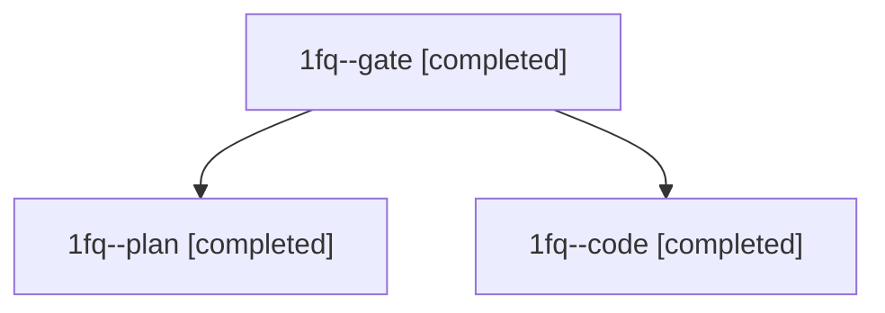

# Session: 1fq

[Agent Hoods](../README.md) / [bbugyi200](../users/bbugyi200/README.md) / [athena](../users/bbugyi200/machines/athena/README.md) / [1fq](../users/bbugyi200/machines/athena/hoods/1fq/README.md) / 1fq

Owner: `bbugyi200.athena` · Hood: `1fq` · Members: 3

## Lineage

The diagram is an optional enhancement; the ordered table below contains the same lineage in accessible text.

| Role | Agent | State | Model / provider | Timing | Commits | Prompt | Chat |
|---|---|---|---|---|---:|---|---|
| gate | 1fq--gate | completed | opus / claude | 2026-11-24T16:54:00.043468+00:00 → 2026-11-24T16:54:36.574358+00:00 | 0 | — | [Chat](../agents/bbugyi200.athena.1fq--gate/chat.md) |
| plan | 1fq--plan | completed | opus / claude | 2026-11-24T16:28:56.801989+00:00 → 2026-11-24T16:49:39.104147+00:00 | 0 | [Prompt](../agents/bbugyi200.athena.1fq--plan/prompt.md) | [Chat](../agents/bbugyi200.athena.1fq--plan/chat.md) |
| code | 1fq--code | completed | muse-spark-1.3-contributor / muse | 2026-11-24T16:54:57.793621+00:00 → 2026-11-24T17:12:47.480410+00:00 | [1](../agents/bbugyi200.athena.1fq--code/README.md#commits) | [Prompt](../agents/bbugyi200.athena.1fq--code/prompt.md) | [Chat](../agents/bbugyi200.athena.1fq--code/chat.md) |

## Commits

| Role | Repo | Commit | Subject | Committed |
|---|---|---|---|---|
| code | bob-cli | [`4ce2129`](https://github.com/bobs-org/bob-cli/commit/4ce2129c55d8b98ad73b13a4f4f04b0819730e8c) | fix(meetings): repair master build broken by meetings notes layer | 2026-11-24 12:12:35 EST |
