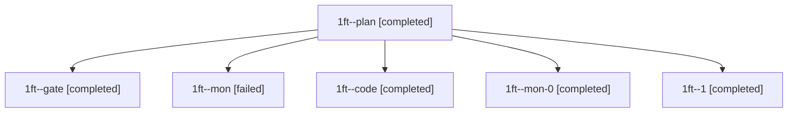

# Session: 1ft

[Agent Hoods](../README.md) / [bbugyi200](../users/bbugyi200/README.md) / [athena](../users/bbugyi200/machines/athena/README.md) / [1ft](../users/bbugyi200/machines/athena/hoods/1ft/README.md) / 1ft

Owner: `bbugyi200.athena` · Hood: `1ft` · Members: 6

## Lineage

The diagram is an optional enhancement; the ordered table below contains the same lineage in accessible text.

| Role | Agent | State | Model / provider | Timing | Commits | Prompt | Chat |
|---|---|---|---|---|---:|---|---|
| plan | 1ft--plan | completed | opus / claude | 2026-11-24T20:50:50.781165+00:00 → 2026-11-24T21:05:52.099059+00:00 | 0 | [Prompt](../agents/bbugyi200.athena.1ft--plan/prompt.md) | [Chat](../agents/bbugyi200.athena.1ft--plan/chat.md) |
| gate | 1ft--gate | completed | opus / claude | 2026-11-24T21:07:36.132905+00:00 → 2026-11-24T21:08:10.173253+00:00 | 0 | — | [Chat](../agents/bbugyi200.athena.1ft--gate/chat.md) |
| mon | 1ft--mon | failed | grok-4.6 / grok | 2026-11-24T21:23:24.194472+00:00 → 2026-11-24T21:45:28.175303+00:00 | 0 | — | [Chat](../agents/bbugyi200.athena.1ft--mon/chat.md) |
| code | 1ft--code | completed | grok-4.6 / grok | 2026-11-24T21:08:31.028946+00:00 → 2026-11-24T21:24:21.263633+00:00 | 0 | [Prompt](../agents/bbugyi200.athena.1ft--code/prompt.md) | [Chat](../agents/bbugyi200.athena.1ft--code/chat.md) |
| mon-0 | 1ft--mon-0 | completed | grok-4.6 / grok | 2026-11-24T21:48:24.014797+00:00 → 2026-11-24T22:08:14.611902+00:00 | 0 | — | — |
| 1 | 1ft--1 | completed | grok-4.6 / grok | 2026-11-24T21:45:28.038054+00:00 → 2026-11-24T21:49:03.200174+00:00 | 0 | [Prompt](../agents/bbugyi200.athena.1ft--1/prompt.md) | [Chat](../agents/bbugyi200.athena.1ft--1/chat.md) |
