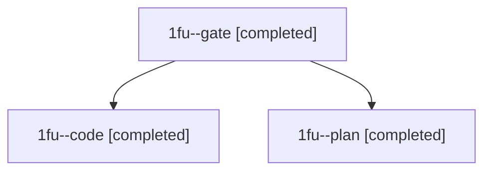

# Session: 1fu

[Agent Hoods](../README.md) / [bbugyi200](../users/bbugyi200/README.md) / [athena](../users/bbugyi200/machines/athena/README.md) / [1fu](../users/bbugyi200/machines/athena/hoods/1fu/README.md) / 1fu

Owner: `bbugyi200.athena` · Hood: `1fu` · Members: 3

## Lineage

The diagram is an optional enhancement; the ordered table below contains the same lineage in accessible text.

| Role | Agent | State | Model / provider | Timing | Commits | Prompt | Chat |
|---|---|---|---|---|---:|---|---|
| gate | 1fu--gate | completed | opus / claude | 2026-11-24T21:03:35.753657+00:00 → 2026-11-24T21:03:58.610152+00:00 | 0 | — | [Chat](../agents/bbugyi200.athena.1fu--gate/chat.md) |
| code | 1fu--code | completed | grok-4.6 / grok | 2026-11-24T21:04:20.335277+00:00 → 2026-11-24T21:27:45.933132+00:00 | [1](../agents/bbugyi200.athena.1fu--code/README.md#commits) | [Prompt](../agents/bbugyi200.athena.1fu--code/prompt.md) | [Chat](../agents/bbugyi200.athena.1fu--code/chat.md) |
| plan | 1fu--plan | completed | opus / claude | 2026-11-24T20:55:44.227951+00:00 → 2026-11-24T21:03:01.215907+00:00 | 0 | [Prompt](../agents/bbugyi200.athena.1fu--plan/prompt.md) | [Chat](../agents/bbugyi200.athena.1fu--plan/chat.md) |

## Commits

| Role | Repo | Commit | Subject | Committed |
|---|---|---|---|---|
| code | bob-cli | [`69e5fcb`](https://github.com/bobs-org/bob-cli/commit/69e5fcb92528dd8435db562343d43ce647ae98f9) | fix(gmail): observe filed threads open in the same sync | 2026-11-24 16:27:31 EST |
