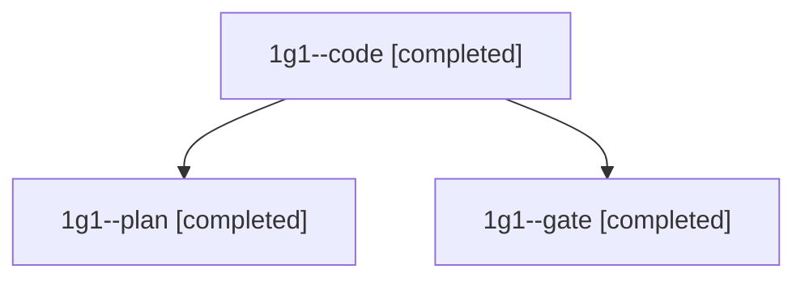

# Session: 1g1

[Agent Hoods](../README.md) / [bbugyi200](../users/bbugyi200/README.md) / [athena](../users/bbugyi200/machines/athena/README.md) / [1g1](../users/bbugyi200/machines/athena/hoods/1g1/README.md) / 1g1

Owner: `bbugyi200.athena` · Hood: `1g1` · Members: 3

## Lineage

The diagram is an optional enhancement; the ordered table below contains the same lineage in accessible text.

| Role | Agent | State | Model / provider | Timing | Commits | Prompt | Chat |
|---|---|---|---|---|---:|---|---|
| code | 1g1--code | completed | grok-4.6 / grok | 2026-11-25T16:27:42.558060+00:00 → 2026-11-25T17:18:28.881240+00:00 | 0 | [Prompt](../agents/bbugyi200.athena.1g1--code/prompt.md) | [Chat](../agents/bbugyi200.athena.1g1--code/chat.md) |
| plan | 1g1--plan | completed | opus / claude | 2026-11-25T15:58:51.312476+00:00 → 2026-11-25T16:19:51.867548+00:00 | 0 | [Prompt](../agents/bbugyi200.athena.1g1--plan/prompt.md) | [Chat](../agents/bbugyi200.athena.1g1--plan/chat.md) |
| gate | 1g1--gate | completed | opus / claude | 2026-11-25T16:26:23.223792+00:00 → 2026-11-25T16:27:00.665514+00:00 | 0 | — | [Chat](../agents/bbugyi200.athena.1g1--gate/chat.md) |
