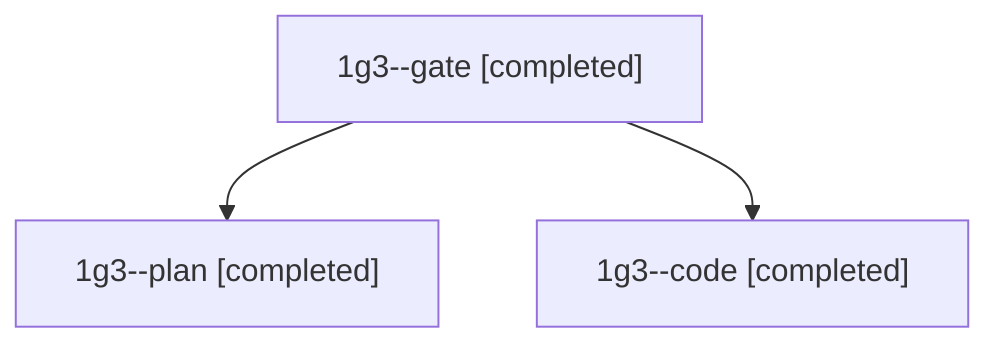

# Session: 1g3

[Agent Hoods](../README.md) / [bbugyi200](../users/bbugyi200/README.md) / [athena](../users/bbugyi200/machines/athena/README.md) / [1g3](../users/bbugyi200/machines/athena/hoods/1g3/README.md) / 1g3

Owner: `bbugyi200.athena` · Hood: `1g3` · Members: 3

## Lineage

The diagram is an optional enhancement; the ordered table below contains the same lineage in accessible text.

| Role | Agent | State | Model / provider | Timing | Commits | Prompt | Chat |
|---|---|---|---|---|---:|---|---|
| gate | 1g3--gate | completed | opus / claude | 2026-11-25T19:13:49.380849+00:00 → 2026-11-25T19:14:39.299682+00:00 | 0 | — | [Chat](../agents/bbugyi200.athena.1g3--gate/chat.md) |
| plan | 1g3--plan | completed | opus / claude | 2026-11-25T18:54:26.089427+00:00 → 2026-11-25T19:09:51.792446+00:00 | 0 | [Prompt](../agents/bbugyi200.athena.1g3--plan/prompt.md) | [Chat](../agents/bbugyi200.athena.1g3--plan/chat.md) |
| code | 1g3--code | completed | muse-spark-1.3-contributor / muse | 2026-11-25T19:15:03.641891+00:00 → 2026-11-25T19:44:07.317765+00:00 | 0 | [Prompt](../agents/bbugyi200.athena.1g3--code/prompt.md) | [Chat](../agents/bbugyi200.athena.1g3--code/chat.md) |
