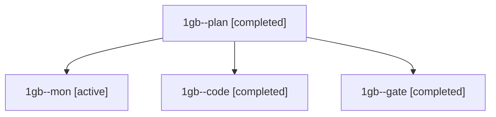

# Session: 1gb

[Agent Hoods](../README.md) / [bbugyi200](../users/bbugyi200/README.md) / [athena](../users/bbugyi200/machines/athena/README.md) / [1gb](../users/bbugyi200/machines/athena/hoods/1gb/README.md) / 1gb

Owner: `bbugyi200.athena` · Hood: `1gb` · Members: 4

## Lineage

The diagram is an optional enhancement; the ordered table below contains the same lineage in accessible text.

| Role | Agent | State | Model / provider | Timing | Commits | Prompt | Chat |
|---|---|---|---|---|---:|---|---|
| plan | 1gb--plan | completed | opus / claude | 2026-11-26T09:48:28.932341+00:00 → 2026-11-26T09:59:44.622473+00:00 | 0 | [Prompt](../agents/bbugyi200.athena.1gb--plan/prompt.md) | [Chat](../agents/bbugyi200.athena.1gb--plan/chat.md) |
| mon | 1gb--mon | active | gpt-6-luna / codex | 2026-11-26T10:23:02.787734+00:00 | 0 | — | — |
| code | 1gb--code | completed | gpt-6-luna / codex | 2026-11-26T10:01:31.956702+00:00 → 2026-11-26T10:24:09.284050+00:00 | 0 | [Prompt](../agents/bbugyi200.athena.1gb--code/prompt.md) | [Chat](../agents/bbugyi200.athena.1gb--code/chat.md) |
| gate | 1gb--gate | completed | opus / claude | 2026-11-26T10:00:21.687312+00:00 → 2026-11-26T10:01:07.218776+00:00 | 0 | — | [Chat](../agents/bbugyi200.athena.1gb--gate/chat.md) |
