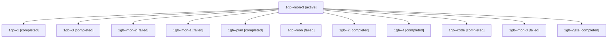

# Session: 1gb

[Agent Hoods](../README.md) / [bbugyi200](../users/bbugyi200/README.md) / [athena](../users/bbugyi200/machines/athena/README.md) / [1gb](../users/bbugyi200/machines/athena/hoods/1gb/README.md) / 1gb

Owner: `bbugyi200.athena` · Hood: `1gb` · Members: 12

## Lineage



The diagram is an optional enhancement; the ordered table below contains the same lineage in accessible text.

| Role | Agent | State | Model / provider | Timing | Commits | Prompt | Chat |
|---|---|---|---|---|---:|---|---|
| <a id="member-mon-3"></a>mon-3 | 1gb--mon-3 | active | gpt-6-luna / codex | 2026-11-26T11:32:01.060232+00:00 | 0 | — | — |
| <a id="member-1"></a>1 | 1gb--1 | completed | gpt-6-luna / codex | 2026-11-26T10:30:14.485632+00:00 → 2026-11-26T10:35:52.767676+00:00 | 0 | [Prompt](../agents/bbugyi200.athena.1gb--1/prompt.md) | [Chat](../agents/bbugyi200.athena.1gb--1/chat.md) |
| <a id="member-3"></a>3 | 1gb--3 | completed | gpt-6-luna / codex | 2026-11-26T11:08:02.678603+00:00 → 2026-11-26T11:13:41.079552+00:00 | 0 | [Prompt](../agents/bbugyi200.athena.1gb--3/prompt.md) | [Chat](../agents/bbugyi200.athena.1gb--3/chat.md) |
| <a id="member-mon-2"></a>mon-2 | 1gb--mon-2 | failed | gpt-6-luna / codex | 2026-11-26T11:12:57.632572+00:00 → 2026-11-26T11:26:27.885609+00:00 | 0 | — | [Chat](../agents/bbugyi200.athena.1gb--mon-2/chat.md) |
| <a id="member-mon-1"></a>mon-1 | 1gb--mon-1 | failed | gpt-6-luna / codex | 2026-11-26T11:05:12.386808+00:00 → 2026-11-26T11:08:03.027913+00:00 | 0 | — | [Chat](../agents/bbugyi200.athena.1gb--mon-1/chat.md) |
| <a id="member-plan"></a>plan | 1gb--plan | completed | opus / claude | 2026-11-26T09:48:28.932341+00:00 → 2026-11-26T09:59:44.622473+00:00 | 0 | [Prompt](../agents/bbugyi200.athena.1gb--plan/prompt.md) | [Chat](../agents/bbugyi200.athena.1gb--plan/chat.md) |
| <a id="member-mon"></a>mon | 1gb--mon | failed | gpt-6-luna / codex | 2026-11-26T10:23:02.787734+00:00 → 2026-11-26T10:30:14.858023+00:00 | 0 | — | [Chat](../agents/bbugyi200.athena.1gb--mon/chat.md) |
| <a id="member-2"></a>2 | 1gb--2 | completed | gpt-6-luna / codex | 2026-11-26T10:47:52.017205+00:00 → 2026-11-26T11:06:44.366733+00:00 | 0 | [Prompt](../agents/bbugyi200.athena.1gb--2/prompt.md) | [Chat](../agents/bbugyi200.athena.1gb--2/chat.md) |
| <a id="member-4"></a>4 | 1gb--4 | completed | gpt-6-luna / codex | 2026-11-26T11:26:27.542939+00:00 → 2026-11-26T11:33:44.965713+00:00 | 0 | [Prompt](../agents/bbugyi200.athena.1gb--4/prompt.md) | [Chat](../agents/bbugyi200.athena.1gb--4/chat.md) |
| <a id="member-code"></a>code | 1gb--code | completed | gpt-6-luna / codex | 2026-11-26T10:01:31.956702+00:00 → 2026-11-26T10:24:09.284050+00:00 | 0 | [Prompt](../agents/bbugyi200.athena.1gb--code/prompt.md) | [Chat](../agents/bbugyi200.athena.1gb--code/chat.md) |
| <a id="member-mon-0"></a>mon-0 | 1gb--mon-0 | failed | gpt-6-luna / codex | 2026-11-26T10:35:00.635833+00:00 → 2026-11-26T10:47:52.525262+00:00 | 0 | — | [Chat](../agents/bbugyi200.athena.1gb--mon-0/chat.md) |
| <a id="member-gate"></a>gate | 1gb--gate | completed | opus / claude | 2026-11-26T10:00:21.687312+00:00 → 2026-11-26T10:01:07.218776+00:00 | 0 | — | [Chat](../agents/bbugyi200.athena.1gb--gate/chat.md) |

## Variables

| Role | Variable | Value |
|---|---|---|
| 2 | `artifacts` | \[{kind: markdown, label: Evidence: frees-marks timing bound flake, path: /home/bryan/.sase/artifacts/agents/gh\_bobs-org\_\_bob-cli/20261126054711/frees-marks-timing-flake-evidence-fe69072aa1ce.md, ref:… |

#### artifacts

**Role:** `2`

```yaml
- kind: markdown
  label: Evidence: frees-marks timing bound flake
  path: /home/bryan/.sase/artifacts/agents/gh_bobs-org__bob-cli/20261126054711/frees-marks-timing-flake-evidence-fe69072aa1ce.md
  ref: file:explicit:6d68ad6a6cb26488798b1d35
  source_path: /home/bryan/.local/state/sase/workspaces/bobs-org/bob-cli/bob-cli_16/target/frees-marks-timing-flake-evidence.md
```

Values are truncated for display; see each member's agent meta.json for the full values.
