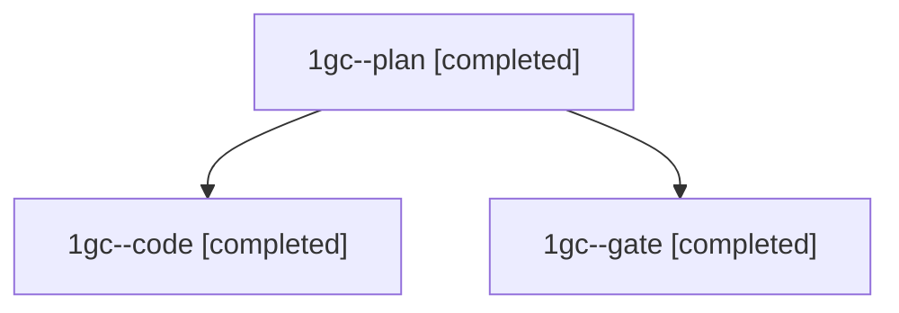

# Session: 1gc

[Agent Hoods](../README.md) / [bbugyi200](../users/bbugyi200/README.md) / [athena](../users/bbugyi200/machines/athena/README.md) / [1gc](../users/bbugyi200/machines/athena/hoods/1gc/README.md) / 1gc

Owner: `bbugyi200.athena` · Hood: `1gc` · Members: 3

## Lineage

The diagram is an optional enhancement; the ordered table below contains the same lineage in accessible text.

| Role | Agent | State | Model / provider | Timing | Commits | Prompt | Chat |
|---|---|---|---|---|---:|---|---|
| plan | 1gc--plan | completed | opus / claude | 2026-11-26T10:21:09.625952+00:00 → 2026-11-26T10:27:36.337309+00:00 | 0 | [Prompt](../agents/bbugyi200.athena.1gc--plan/prompt.md) | [Chat](../agents/bbugyi200.athena.1gc--plan/chat.md) |
| code | 1gc--code | completed | muse-spark-1.3-contributor / muse | 2026-11-26T10:29:04.942166+00:00 → 2026-11-26T10:31:27.129913+00:00 | 0 | [Prompt](../agents/bbugyi200.athena.1gc--code/prompt.md) | [Chat](../agents/bbugyi200.athena.1gc--code/chat.md) |
| gate | 1gc--gate | completed | opus / claude | 2026-11-26T10:27:59.462645+00:00 → 2026-11-26T10:28:39.871954+00:00 | 0 | — | [Chat](../agents/bbugyi200.athena.1gc--gate/chat.md) |
