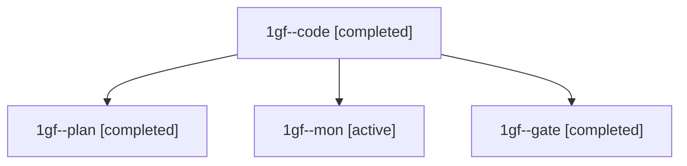

# Session: 1gf

[Agent Hoods](../README.md) / [bbugyi200](../users/bbugyi200/README.md) / [athena](../users/bbugyi200/machines/athena/README.md) / [1gf](../users/bbugyi200/machines/athena/hoods/1gf/README.md) / 1gf

Owner: `bbugyi200.athena` · Hood: `1gf` · Members: 4

## Lineage

The diagram is an optional enhancement; the ordered table below contains the same lineage in accessible text.

| Role | Agent | State | Model / provider | Timing | Commits | Prompt | Chat |
|---|---|---|---|---|---:|---|---|
| code | 1gf--code | completed | gpt-6-luna / codex | 2026-11-26T11:04:16.713833+00:00 → 2026-11-26T11:17:58.145338+00:00 | 0 | [Prompt](../agents/bbugyi200.athena.1gf--code/prompt.md) | [Chat](../agents/bbugyi200.athena.1gf--code/chat.md) |
| plan | 1gf--plan | completed | opus / claude | 2026-11-26T10:40:01.724623+00:00 → 2026-11-26T10:53:15.906825+00:00 | 0 | [Prompt](../agents/bbugyi200.athena.1gf--plan/prompt.md) | [Chat](../agents/bbugyi200.athena.1gf--plan/chat.md) |
| mon | 1gf--mon | active | gpt-6-luna / codex | 2026-11-26T11:16:21.059322+00:00 | 0 | — | — |
| gate | 1gf--gate | completed | opus / claude | 2026-11-26T11:03:26.171823+00:00 → 2026-11-26T11:03:48.854812+00:00 | 0 | — | [Chat](../agents/bbugyi200.athena.1gf--gate/chat.md) |
