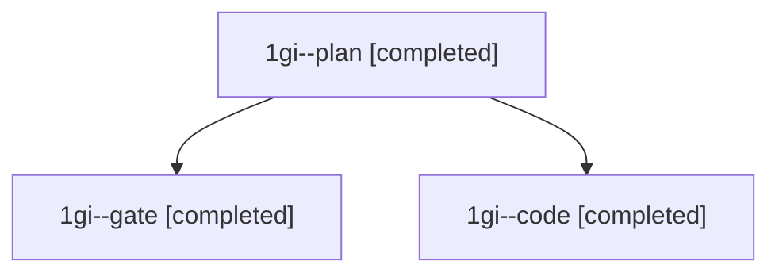

# Session: 1gi

[Agent Hoods](../README.md) / [bbugyi200](../users/bbugyi200/README.md) / [athena](../users/bbugyi200/machines/athena/README.md) / [1gi](../users/bbugyi200/machines/athena/hoods/1gi/README.md) / 1gi

Owner: `bbugyi200.athena` · Hood: `1gi` · Members: 3

## Lineage

The diagram is an optional enhancement; the ordered table below contains the same lineage in accessible text.

| Role | Agent | State | Model / provider | Timing | Commits | Prompt | Chat |
|---|---|---|---|---|---:|---|---|
| plan | 1gi--plan | completed | opus / claude | 2026-11-26T12:11:46.248231+00:00 → 2026-11-26T12:22:45.407089+00:00 | 0 | [Prompt](../agents/bbugyi200.athena.1gi--plan/prompt.md) | [Chat](../agents/bbugyi200.athena.1gi--plan/chat.md) |
| gate | 1gi--gate | completed | opus / claude | 2026-11-26T12:24:34.956528+00:00 → 2026-11-26T12:25:49.219208+00:00 | 0 | — | [Chat](../agents/bbugyi200.athena.1gi--gate/chat.md) |
| code | 1gi--code | completed | muse-spark-1.3-contributor / muse | 2026-11-26T12:26:13.000823+00:00 → 2026-11-26T12:42:43.986186+00:00 | 0 | [Prompt](../agents/bbugyi200.athena.1gi--code/prompt.md) | [Chat](../agents/bbugyi200.athena.1gi--code/chat.md) |
