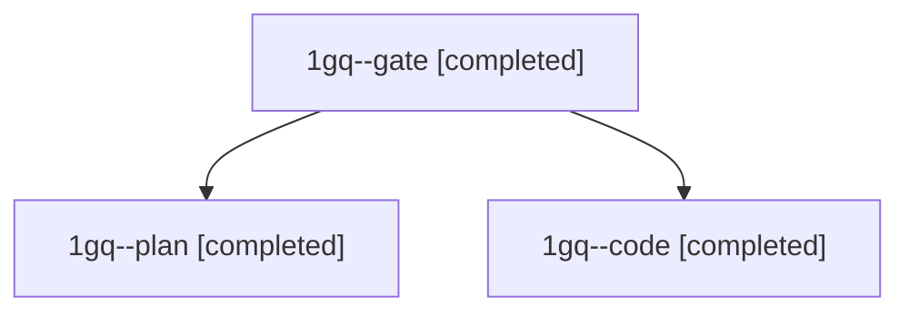

# Session: 1gq

[Agent Hoods](../README.md) / [bbugyi200](../users/bbugyi200/README.md) / [athena](../users/bbugyi200/machines/athena/README.md) / [1gq](../users/bbugyi200/machines/athena/hoods/1gq/README.md) / 1gq

Owner: `bbugyi200.athena` · Hood: `1gq` · Members: 3

## Lineage

The diagram is an optional enhancement; the ordered table below contains the same lineage in accessible text.

| Role | Agent | State | Model / provider | Timing | Commits | Prompt | Chat |
|---|---|---|---|---|---:|---|---|
| gate | 1gq--gate | completed | opus / claude | 2026-11-26T17:18:08.408302+00:00 → 2026-11-26T17:19:11.708816+00:00 | 0 | — | [Chat](../agents/bbugyi200.athena.1gq--gate/chat.md) |
| plan | 1gq--plan | completed | opus / claude | 2026-11-26T16:26:13.655610+00:00 → 2026-11-26T16:32:20.043266+00:00 | 0 | [Prompt](../agents/bbugyi200.athena.1gq--plan/prompt.md) | [Chat](../agents/bbugyi200.athena.1gq--plan/chat.md) |
| code | 1gq--code | completed | muse-spark-1.3-contributor / muse | 2026-11-26T17:19:37.550907+00:00 → 2026-11-26T17:38:54.779191+00:00 | 0 | [Prompt](../agents/bbugyi200.athena.1gq--code/prompt.md) | [Chat](../agents/bbugyi200.athena.1gq--code/chat.md) |
