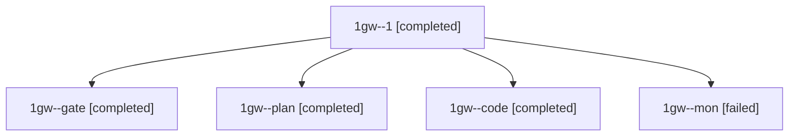

# Session: 1gw

[Agent Hoods](../README.md) / [bbugyi200](../users/bbugyi200/README.md) / [athena](../users/bbugyi200/machines/athena/README.md) / [1gw](../users/bbugyi200/machines/athena/hoods/1gw/README.md) / 1gw

Owner: `bbugyi200.athena` · Hood: `1gw` · Members: 5

## Lineage

The diagram is an optional enhancement; the ordered table below contains the same lineage in accessible text.

| Role | Agent | State | Model / provider | Timing | Commits | Prompt | Chat |
|---|---|---|---|---|---:|---|---|
| 1 | 1gw--1 | completed | muse-spark-1.3-contributor / muse | 2026-11-27T11:53:43.798693+00:00 → 2026-11-27T11:55:08.792175+00:00 | 0 | [Prompt](../agents/bbugyi200.athena.1gw--1/prompt.md) | [Chat](../agents/bbugyi200.athena.1gw--1/chat.md) |
| gate | 1gw--gate | completed | opus / claude | 2026-11-27T11:14:30.585077+00:00 → 2026-11-27T11:15:33.472974+00:00 | 0 | — | [Chat](../agents/bbugyi200.athena.1gw--gate/chat.md) |
| plan | 1gw--plan | completed | opus / claude | 2026-11-27T10:51:08.280037+00:00 → 2026-11-27T11:13:40.945445+00:00 | 0 | [Prompt](../agents/bbugyi200.athena.1gw--plan/prompt.md) | [Chat](../agents/bbugyi200.athena.1gw--plan/chat.md) |
| code | 1gw--code | completed | muse-spark-1.3-contributor / muse | 2026-11-27T11:15:57.053892+00:00 → 2026-11-27T11:52:05.369077+00:00 | 0 | [Prompt](../agents/bbugyi200.athena.1gw--code/prompt.md) | [Chat](../agents/bbugyi200.athena.1gw--code/chat.md) |
| mon | 1gw--mon | failed | muse-spark-1.3-contributor / muse | 2026-11-27T11:33:44.611998+00:00 → 2026-11-27T11:53:25.563854+00:00 | 0 | — | [Chat](../agents/bbugyi200.athena.1gw--mon/chat.md) |
