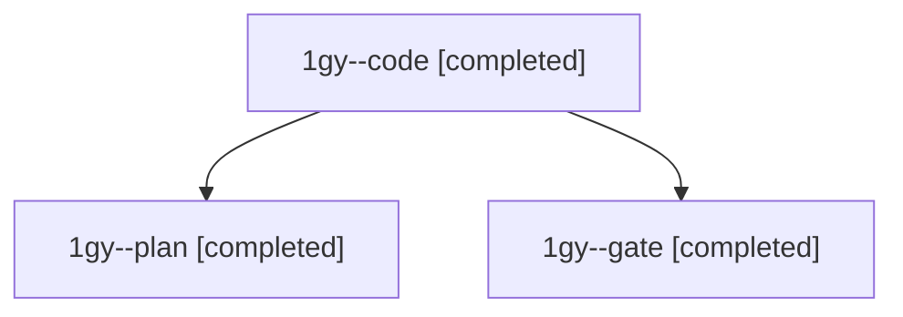

# Session: 1gy

[Agent Hoods](../README.md) / [bbugyi200](../users/bbugyi200/README.md) / [athena](../users/bbugyi200/machines/athena/README.md) / [1gy](../users/bbugyi200/machines/athena/hoods/1gy/README.md) / 1gy

Owner: `bbugyi200.athena` · Hood: `1gy` · Members: 3

## Lineage

The diagram is an optional enhancement; the ordered table below contains the same lineage in accessible text.

| Role | Agent | State | Model / provider | Timing | Commits | Prompt | Chat |
|---|---|---|---|---|---:|---|---|
| code | 1gy--code | completed | muse-spark-1.3-contributor / muse | 2026-11-27T13:01:14.035290+00:00 → 2026-11-27T13:24:57.748510+00:00 | 0 | [Prompt](../agents/bbugyi200.athena.1gy--code/prompt.md) | [Chat](../agents/bbugyi200.athena.1gy--code/chat.md) |
| plan | 1gy--plan | completed | opus / claude | 2026-11-27T12:16:58.294407+00:00 → 2026-11-27T12:45:02.819541+00:00 | 0 | [Prompt](../agents/bbugyi200.athena.1gy--plan/prompt.md) | [Chat](../agents/bbugyi200.athena.1gy--plan/chat.md) |
| gate | 1gy--gate | completed | opus / claude | 2026-11-27T13:00:24.528258+00:00 → 2026-11-27T13:00:49.083569+00:00 | 0 | — | [Chat](../agents/bbugyi200.athena.1gy--gate/chat.md) |
