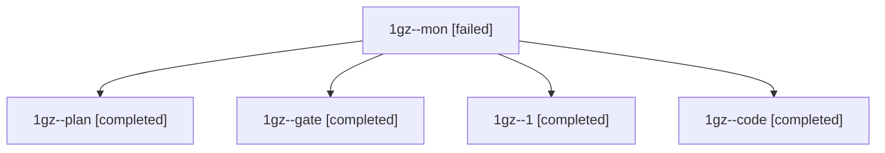

# Session: 1gz

[Agent Hoods](../README.md) / [bbugyi200](../users/bbugyi200/README.md) / [athena](../users/bbugyi200/machines/athena/README.md) / [1gz](../users/bbugyi200/machines/athena/hoods/1gz/README.md) / 1gz

Owner: `bbugyi200.athena` · Hood: `1gz` · Members: 5

## Lineage

The diagram is an optional enhancement; the ordered table below contains the same lineage in accessible text.

| Role | Agent | State | Model / provider | Timing | Commits | Prompt | Chat |
|---|---|---|---|---|---:|---|---|
| mon | 1gz--mon | failed | gpt-6-luna / codex | 2026-11-27T13:26:18.251888+00:00 → 2026-11-27T13:28:59.138688+00:00 | 0 | — | [Chat](../agents/bbugyi200.athena.1gz--mon/chat.md) |
| plan | 1gz--plan | completed | opus / claude | 2026-11-27T12:25:39.426072+00:00 → 2026-11-27T12:40:06.019510+00:00 | 0 | [Prompt](../agents/bbugyi200.athena.1gz--plan/prompt.md) | [Chat](../agents/bbugyi200.athena.1gz--plan/chat.md) |
| gate | 1gz--gate | completed | opus / claude | 2026-11-27T13:00:00.960595+00:00 → 2026-11-27T13:00:23.391266+00:00 | 0 | — | [Chat](../agents/bbugyi200.athena.1gz--gate/chat.md) |
| 1 | 1gz--1 | completed | gpt-6-luna / codex | 2026-11-27T13:28:59.070913+00:00 → 2026-11-27T14:30:30.562161+00:00 | 0 | [Prompt](../agents/bbugyi200.athena.1gz--1/prompt.md) | [Chat](../agents/bbugyi200.athena.1gz--1/chat.md) |
| code | 1gz--code | completed | gpt-6-luna / codex | 2026-11-27T13:00:47.315932+00:00 → 2026-11-27T13:27:30.266401+00:00 | 0 | [Prompt](../agents/bbugyi200.athena.1gz--code/prompt.md) | [Chat](../agents/bbugyi200.athena.1gz--code/chat.md) |
