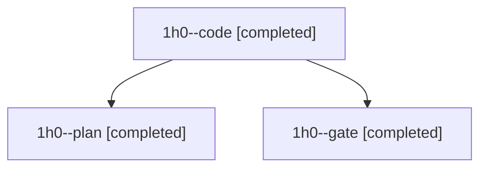

# Session: 1h0

[Agent Hoods](../README.md) / [bbugyi200](../users/bbugyi200/README.md) / [athena](../users/bbugyi200/machines/athena/README.md) / [1h0](../users/bbugyi200/machines/athena/hoods/1h0/README.md) / 1h0

Owner: `bbugyi200.athena` · Hood: `1h0` · Members: 3

## Lineage

The diagram is an optional enhancement; the ordered table below contains the same lineage in accessible text.

| Role | Agent | State | Model / provider | Timing | Commits | Prompt | Chat |
|---|---|---|---|---|---:|---|---|
| code | 1h0--code | completed | muse-spark-1.3-contributor / muse | 2026-11-27T13:14:49.586407+00:00 → 2026-11-27T13:46:27.906552+00:00 | 0 | [Prompt](../agents/bbugyi200.athena.1h0--code/prompt.md) | [Chat](../agents/bbugyi200.athena.1h0--code/chat.md) |
| plan | 1h0--plan | completed | opus / claude | 2026-11-27T13:00:05.899059+00:00 → 2026-11-27T13:11:16.582544+00:00 | 0 | [Prompt](../agents/bbugyi200.athena.1h0--plan/prompt.md) | [Chat](../agents/bbugyi200.athena.1h0--plan/chat.md) |
| gate | 1h0--gate | completed | opus / claude | 2026-11-27T13:13:43.157961+00:00 → 2026-11-27T13:14:25.416987+00:00 | 0 | — | [Chat](../agents/bbugyi200.athena.1h0--gate/chat.md) |
