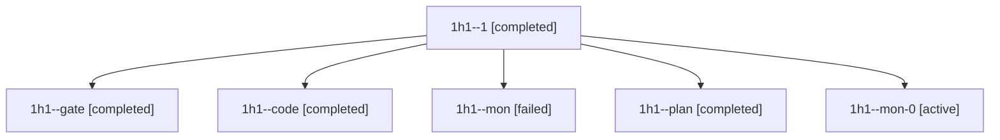

# Session: 1h1

[Agent Hoods](../README.md) / [bbugyi200](../users/bbugyi200/README.md) / [athena](../users/bbugyi200/machines/athena/README.md) / [1h1](../users/bbugyi200/machines/athena/hoods/1h1/README.md) / 1h1

Owner: `bbugyi200.athena` · Hood: `1h1` · Members: 6

## Lineage

The diagram is an optional enhancement; the ordered table below contains the same lineage in accessible text.

| Role | Agent | State | Model / provider | Timing | Commits | Prompt | Chat |
|---|---|---|---|---|---:|---|---|
| 1 | 1h1--1 | completed | gpt-6-luna / codex | 2026-11-27T14:33:27.968693+00:00 → 2026-11-27T14:46:32.351379+00:00 | 0 | [Prompt](../agents/bbugyi200.athena.1h1--1/prompt.md) | [Chat](../agents/bbugyi200.athena.1h1--1/chat.md) |
| gate | 1h1--gate | completed | opus / claude | 2026-11-27T14:12:15.124776+00:00 → 2026-11-27T14:12:52.139210+00:00 | 0 | — | [Chat](../agents/bbugyi200.athena.1h1--gate/chat.md) |
| code | 1h1--code | completed | gpt-6-luna / codex | 2026-11-27T14:13:15.364490+00:00 → 2026-11-27T14:30:29.617269+00:00 | 0 | [Prompt](../agents/bbugyi200.athena.1h1--code/prompt.md) | [Chat](../agents/bbugyi200.athena.1h1--code/chat.md) |
| mon | 1h1--mon | failed | gpt-6-luna / codex | 2026-11-27T14:29:21.484389+00:00 → 2026-11-27T14:33:28.437219+00:00 | 0 | — | [Chat](../agents/bbugyi200.athena.1h1--mon/chat.md) |
| plan | 1h1--plan | completed | opus / claude | 2026-11-27T14:04:13.183203+00:00 → 2026-11-27T14:12:01.531063+00:00 | 0 | [Prompt](../agents/bbugyi200.athena.1h1--plan/prompt.md) | [Chat](../agents/bbugyi200.athena.1h1--plan/chat.md) |
| mon-0 | 1h1--mon-0 | active | gpt-6-luna / codex | 2026-11-27T14:45:07.820115+00:00 | 0 | — | — |
