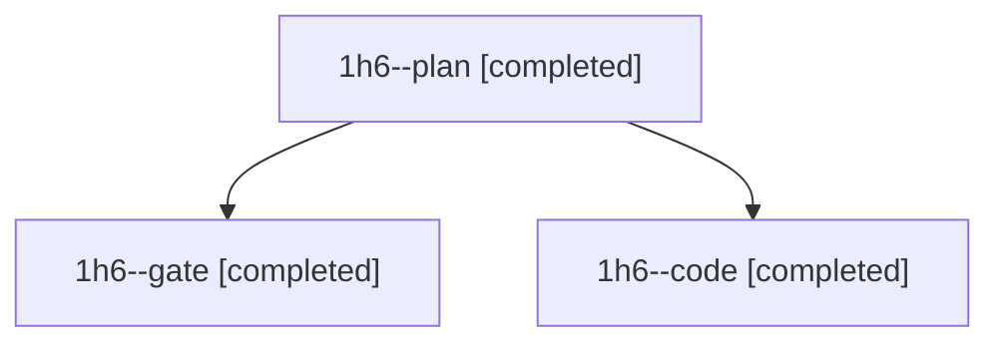

# Session: 1h6

[Agent Hoods](../README.md) / [bbugyi200](../users/bbugyi200/README.md) / [athena](../users/bbugyi200/machines/athena/README.md) / [1h6](../users/bbugyi200/machines/athena/hoods/1h6/README.md) / 1h6

Owner: `bbugyi200.athena` · Hood: `1h6` · Members: 3

## Lineage

The diagram is an optional enhancement; the ordered table below contains the same lineage in accessible text.

| Role | Agent | State | Model / provider | Timing | Commits | Prompt | Chat |
|---|---|---|---|---|---:|---|---|
| plan | 1h6--plan | completed | opus / claude | 2026-11-27T15:28:34.197366+00:00 → 2026-11-27T15:38:48.815882+00:00 | 0 | [Prompt](../agents/bbugyi200.athena.1h6--plan/prompt.md) | [Chat](../agents/bbugyi200.athena.1h6--plan/chat.md) |
| gate | 1h6--gate | completed | opus / claude | 2026-11-27T15:39:41.151369+00:00 → 2026-11-27T15:40:21.067295+00:00 | 0 | — | [Chat](../agents/bbugyi200.athena.1h6--gate/chat.md) |
| code | 1h6--code | completed | muse-spark-1.3-contributor / muse | 2026-11-27T15:40:44.420508+00:00 → 2026-11-27T16:40:25.701796+00:00 | [1](../agents/bbugyi200.athena.1h6--code/README.md#commits) | [Prompt](../agents/bbugyi200.athena.1h6--code/prompt.md) | [Chat](../agents/bbugyi200.athena.1h6--code/chat.md) |

## Commits

| Role | Repo | Commit | Subject | Committed |
|---|---|---|---|---|
| code | bob-cli | [`11b0243`](https://github.com/bobs-org/bob-cli/commit/11b0243e808cdc388a86e7c80e3961ac0060d3f8) | feat(props)!: report "=" as the card editor gesture | 2026-11-27 11:40:03 EST |
