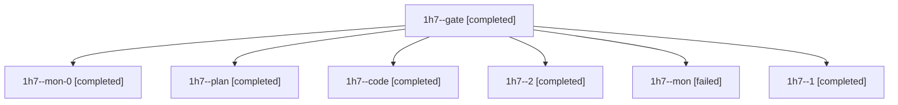

# Session: 1h7

[Agent Hoods](../README.md) / [bbugyi200](../users/bbugyi200/README.md) / [athena](../users/bbugyi200/machines/athena/README.md) / [1h7](../users/bbugyi200/machines/athena/hoods/1h7/README.md) / 1h7

Owner: `bbugyi200.athena` · Hood: `1h7` · Members: 7

## Lineage

The diagram is an optional enhancement; the ordered table below contains the same lineage in accessible text.

| Role | Agent | State | Model / provider | Timing | Commits | Prompt | Chat |
|---|---|---|---|---|---:|---|---|
| gate | 1h7--gate | completed | opus / claude | 2026-11-27T15:58:57.441173+00:00 → 2026-11-27T15:59:50.851970+00:00 | 0 | — | [Chat](../agents/bbugyi200.athena.1h7--gate/chat.md) |
| mon-0 | 1h7--mon-0 | completed | grok-4.6 / grok | 2026-11-27T16:38:53.102924+00:00 → 2026-11-27T16:52:43.859047+00:00 | 0 | — | [Chat](../agents/bbugyi200.athena.1h7--mon-0/chat.md) |
| plan | 1h7--plan | completed | opus / claude | 2026-11-27T15:31:29.283659+00:00 → 2026-11-27T15:58:33.682277+00:00 | 0 | [Prompt](../agents/bbugyi200.athena.1h7--plan/prompt.md) | [Chat](../agents/bbugyi200.athena.1h7--plan/chat.md) |
| code | 1h7--code | completed | grok-4.6 / grok | 2026-11-27T16:00:14.989718+00:00 → 2026-11-27T16:23:52.945463+00:00 | 0 | [Prompt](../agents/bbugyi200.athena.1h7--code/prompt.md) | [Chat](../agents/bbugyi200.athena.1h7--code/chat.md) |
| 2 | 1h7--2 | completed | grok-4.6 / grok | 2026-11-27T16:52:43.407340+00:00 → 2026-11-27T17:05:18.512597+00:00 | [1](../agents/bbugyi200.athena.1h7--2/README.md#commits) | [Prompt](../agents/bbugyi200.athena.1h7--2/prompt.md) | [Chat](../agents/bbugyi200.athena.1h7--2/chat.md) |
| mon | 1h7--mon | failed | grok-4.6 / grok | 2026-11-27T16:22:37.482612+00:00 → 2026-11-27T16:28:30.144702+00:00 | 0 | — | [Chat](../agents/bbugyi200.athena.1h7--mon/chat.md) |
| 1 | 1h7--1 | completed | grok-4.6 / grok | 2026-11-27T16:28:29.773893+00:00 → 2026-11-27T16:41:08.500265+00:00 | 0 | [Prompt](../agents/bbugyi200.athena.1h7--1/prompt.md) | [Chat](../agents/bbugyi200.athena.1h7--1/chat.md) |

## Commits

| Role | Repo | Commit | Subject | Committed |
|---|---|---|---|---|
| 2 | bob-cli | [`7213dd8`](https://github.com/bobs-org/bob-cli/commit/7213dd89b425a58486b415ed8ca757bd45a8b37c) | fix(snooze)!: skip automatic wake sweeps when timezone is unset | 2026-11-27 12:04:51 EST |
