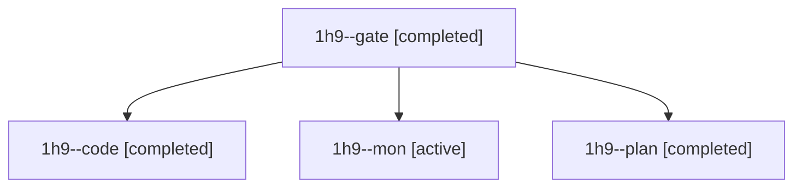

# Session: 1h9

[Agent Hoods](../README.md) / [bbugyi200](../users/bbugyi200/README.md) / [athena](../users/bbugyi200/machines/athena/README.md) / [1h9](../users/bbugyi200/machines/athena/hoods/1h9/README.md) / 1h9

Owner: `bbugyi200.athena` · Hood: `1h9` · Members: 4

## Lineage

The diagram is an optional enhancement; the ordered table below contains the same lineage in accessible text.

| Role | Agent | State | Model / provider | Timing | Commits | Prompt | Chat |
|---|---|---|---|---|---:|---|---|
| gate | 1h9--gate | completed | opus / claude | 2026-11-27T17:30:37.736682+00:00 → 2026-11-27T17:31:03.091626+00:00 | 0 | — | [Chat](../agents/bbugyi200.athena.1h9--gate/chat.md) |
| code | 1h9--code | completed | muse-spark-1.3-contributor / muse | 2026-11-27T17:31:31.282840+00:00 → 2026-11-27T17:51:14.629958+00:00 | 0 | [Prompt](../agents/bbugyi200.athena.1h9--code/prompt.md) | [Chat](../agents/bbugyi200.athena.1h9--code/chat.md) |
| mon | 1h9--mon | active | muse-spark-1.3-contributor / muse | 2026-11-27T17:49:47.439641+00:00 | 0 | — | — |
| plan | 1h9--plan | completed | opus / claude | 2026-11-27T17:15:20.747264+00:00 → 2026-11-27T17:30:00.555297+00:00 | 0 | [Prompt](../agents/bbugyi200.athena.1h9--plan/prompt.md) | [Chat](../agents/bbugyi200.athena.1h9--plan/chat.md) |
