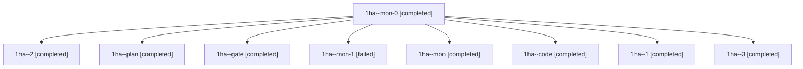

# Session: 1ha

[Agent Hoods](../README.md) / [bbugyi200](../users/bbugyi200/README.md) / [athena](../users/bbugyi200/machines/athena/README.md) / [1ha](../users/bbugyi200/machines/athena/hoods/1ha/README.md) / 1ha

Owner: `bbugyi200.athena` · Hood: `1ha` · Members: 9

## Lineage

The diagram is an optional enhancement; the ordered table below contains the same lineage in accessible text.

| Role | Agent | State | Model / provider | Timing | Commits | Prompt | Chat |
|---|---|---|---|---|---:|---|---|
| mon-0 | 1ha--mon-0 | completed | gpt-6-luna / codex | 2026-11-27T18:23:08.108547+00:00 → 2026-11-27T18:26:03.219559+00:00 | 0 | — | [Chat](../agents/bbugyi200.athena.1ha--mon-0/chat.md) |
| 2 | 1ha--2 | completed | gpt-6-luna / codex | 2026-11-27T18:26:02.805377+00:00 → 2026-11-27T18:29:02.642125+00:00 | 0 | [Prompt](../agents/bbugyi200.athena.1ha--2/prompt.md) | [Chat](../agents/bbugyi200.athena.1ha--2/chat.md) |
| plan | 1ha--plan | completed | opus / claude | 2026-11-27T17:27:20.557068+00:00 → 2026-11-27T17:45:05.519183+00:00 | 0 | [Prompt](../agents/bbugyi200.athena.1ha--plan/prompt.md) | [Chat](../agents/bbugyi200.athena.1ha--plan/chat.md) |
| gate | 1ha--gate | completed | opus / claude | 2026-11-27T17:45:43.927182+00:00 → 2026-11-27T17:48:10.621505+00:00 | 0 | — | [Chat](../agents/bbugyi200.athena.1ha--gate/chat.md) |
| mon-1 | 1ha--mon-1 | failed | gpt-6-luna / codex | 2026-11-27T18:28:19.028078+00:00 → 2026-11-27T18:31:19.438757+00:00 | 0 | — | [Chat](../agents/bbugyi200.athena.1ha--mon-1/chat.md) |
| mon | 1ha--mon | completed | gpt-6-luna / codex | 2026-11-27T18:02:42.754912+00:00 → 2026-11-27T18:05:43.561618+00:00 | 0 | — | [Chat](../agents/bbugyi200.athena.1ha--mon/chat.md) |
| code | 1ha--code | completed | gpt-6-luna / codex | 2026-11-27T17:48:37.532034+00:00 → 2026-11-27T18:03:45.715259+00:00 | 0 | [Prompt](../agents/bbugyi200.athena.1ha--code/prompt.md) | [Chat](../agents/bbugyi200.athena.1ha--code/chat.md) |
| 1 | 1ha--1 | completed | gpt-6-luna / codex | 2026-11-27T18:05:43.482899+00:00 → 2026-11-27T18:24:07.432738+00:00 | 0 | [Prompt](../agents/bbugyi200.athena.1ha--1/prompt.md) | [Chat](../agents/bbugyi200.athena.1ha--1/chat.md) |
| 3 | 1ha--3 | completed | gpt-6-luna / codex | 2026-11-27T18:31:19.139663+00:00 → 2026-11-27T18:46:27.748225+00:00 | [1](../agents/bbugyi200.athena.1ha--3/README.md#commits) | [Prompt](../agents/bbugyi200.athena.1ha--3/prompt.md) | [Chat](../agents/bbugyi200.athena.1ha--3/chat.md) |

## Commits

| Role | Repo | Commit | Subject | Committed |
|---|---|---|---|---|
| 3 | bob-cli | [`6f12dd0`](https://github.com/bobs-org/bob-cli/commit/6f12dd0d2e25a5d591abfc95798e054c58711e0c) | docs(tasks): document task dependencies | 2026-11-27 13:45:59 EST |
