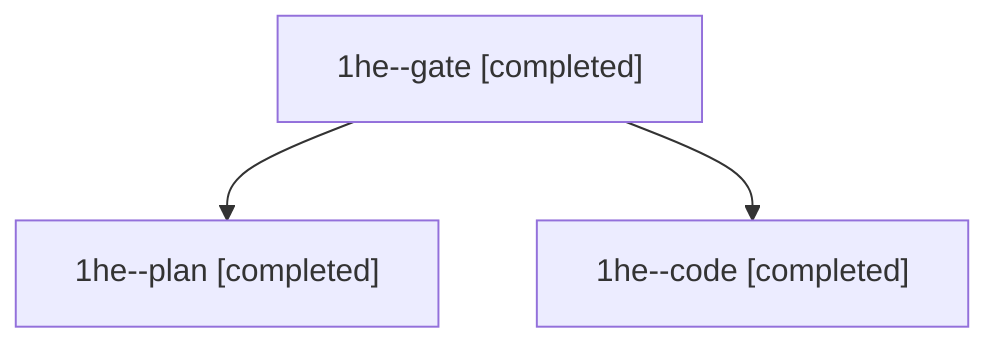

# Session: 1he

[Agent Hoods](../README.md) / [bbugyi200](../users/bbugyi200/README.md) / [athena](../users/bbugyi200/machines/athena/README.md) / [1he](../users/bbugyi200/machines/athena/hoods/1he/README.md) / 1he

Owner: `bbugyi200.athena` · Hood: `1he` · Members: 3

## Lineage

The diagram is an optional enhancement; the ordered table below contains the same lineage in accessible text.

| Role | Agent | State | Model / provider | Timing | Commits | Prompt | Chat |
|---|---|---|---|---|---:|---|---|
| gate | 1he--gate | completed | opus / claude | 2026-11-27T19:34:04.988288+00:00 → 2026-11-27T19:34:31.361802+00:00 | 0 | — | [Chat](../agents/bbugyi200.athena.1he--gate/chat.md) |
| plan | 1he--plan | completed | opus / claude | 2026-11-27T19:27:58.577025+00:00 → 2026-11-27T19:33:53.244335+00:00 | 0 | [Prompt](../agents/bbugyi200.athena.1he--plan/prompt.md) | [Chat](../agents/bbugyi200.athena.1he--plan/chat.md) |
| code | 1he--code | completed | muse-spark-1.3-contributor / muse | 2026-11-27T19:34:56.091694+00:00 → 2026-11-27T19:57:09.468762+00:00 | [1](../agents/bbugyi200.athena.1he--code/README.md#commits) | [Prompt](../agents/bbugyi200.athena.1he--code/prompt.md) | [Chat](../agents/bbugyi200.athena.1he--code/chat.md) |

## Commits

| Role | Repo | Commit | Subject | Committed |
|---|---|---|---|---|
| code | bob-cli | [`cbbddc7`](https://github.com/bobs-org/bob-cli/commit/cbbddc71f4a6879a8705a5cf1010921aea9b5c4f) | docs(blocked-marks): always show priority bars on Blocked digit rows | 2026-11-27 14:56:44 EST |
