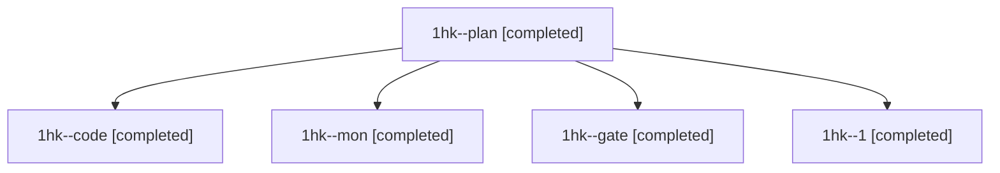

# Session: 1hk

[Agent Hoods](../README.md) / [bbugyi200](../users/bbugyi200/README.md) / [athena](../users/bbugyi200/machines/athena/README.md) / [1hk](../users/bbugyi200/machines/athena/hoods/1hk/README.md) / 1hk

Owner: `bbugyi200.athena` · Hood: `1hk` · Members: 5

## Lineage

The diagram is an optional enhancement; the ordered table below contains the same lineage in accessible text.

| Role | Agent | State | Model / provider | Timing | Commits | Prompt | Chat |
|---|---|---|---|---|---:|---|---|
| plan | 1hk--plan | completed | opus / claude | 2026-11-28T00:47:06.041841+00:00 → 2026-11-28T00:56:08.210906+00:00 | 0 | [Prompt](../agents/bbugyi200.athena.1hk--plan/prompt.md) | [Chat](../agents/bbugyi200.athena.1hk--plan/chat.md) |
| code | 1hk--code | completed | muse-spark-1.3-contributor / muse | 2026-11-28T00:57:45.396566+00:00 → 2026-11-28T01:36:13.738406+00:00 | 0 | [Prompt](../agents/bbugyi200.athena.1hk--code/prompt.md) | [Chat](../agents/bbugyi200.athena.1hk--code/chat.md) |
| mon | 1hk--mon | completed | muse-spark-1.3-contributor / muse | 2026-11-28T01:34:50.202049+00:00 → 2026-11-28T01:48:28.368429+00:00 | 0 | — | [Chat](../agents/bbugyi200.athena.1hk--mon/chat.md) |
| gate | 1hk--gate | completed | opus / claude | 2026-11-28T00:56:39.685682+00:00 → 2026-11-28T00:57:20.597881+00:00 | 0 | — | [Chat](../agents/bbugyi200.athena.1hk--gate/chat.md) |
| 1 | 1hk--1 | completed | muse-spark-1.3-contributor / muse | 2026-11-28T01:48:27.794974+00:00 → 2026-11-28T02:06:42.877649+00:00 | [1](../agents/bbugyi200.athena.1hk--1/README.md#commits) | [Prompt](../agents/bbugyi200.athena.1hk--1/prompt.md) | [Chat](../agents/bbugyi200.athena.1hk--1/chat.md) |

## Commits

| Role | Repo | Commit | Subject | Committed |
|---|---|---|---|---|
| 1 | bob-cli | [`f3b231a`](https://github.com/bobs-org/bob-cli/commit/f3b231a89143d1cee831faf97e5a5759c2e79f49) | docs(config,glossary): cabinets start closed unless config opens them | 2026-11-27 21:03:35 EST |
