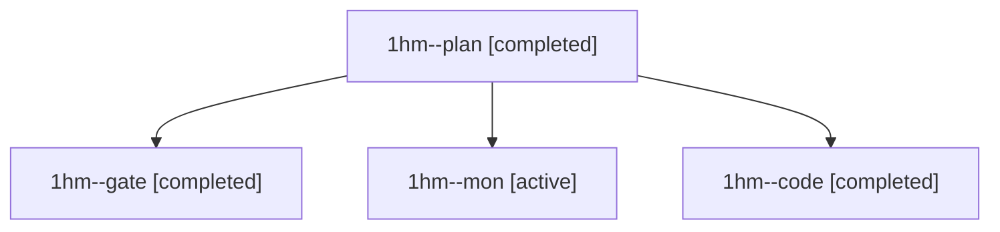

# Session: 1hm

[Agent Hoods](../README.md) / [bbugyi200](../users/bbugyi200/README.md) / [athena](../users/bbugyi200/machines/athena/README.md) / [1hm](../users/bbugyi200/machines/athena/hoods/1hm/README.md) / 1hm

Owner: `bbugyi200.athena` · Hood: `1hm` · Members: 4

## Lineage

The diagram is an optional enhancement; the ordered table below contains the same lineage in accessible text.

| Role | Agent | State | Model / provider | Timing | Commits | Prompt | Chat |
|---|---|---|---|---|---:|---|---|
| plan | 1hm--plan | completed | opus / claude | 2026-11-28T12:31:47.180575+00:00 → 2026-11-28T12:43:18.672171+00:00 | 0 | [Prompt](../agents/bbugyi200.athena.1hm--plan/prompt.md) | [Chat](../agents/bbugyi200.athena.1hm--plan/chat.md) |
| gate | 1hm--gate | completed | opus / claude | 2026-11-28T12:45:07.716285+00:00 → 2026-11-28T12:45:33.426846+00:00 | 0 | — | [Chat](../agents/bbugyi200.athena.1hm--gate/chat.md) |
| mon | 1hm--mon | active | gpt-6-luna / codex | 2026-11-28T13:18:18.404979+00:00 | 0 | — | — |
| code | 1hm--code | completed | gpt-6-luna / codex | 2026-11-28T12:45:57.159274+00:00 → 2026-11-28T13:20:23.180986+00:00 | 0 | [Prompt](../agents/bbugyi200.athena.1hm--code/prompt.md) | [Chat](../agents/bbugyi200.athena.1hm--code/chat.md) |
