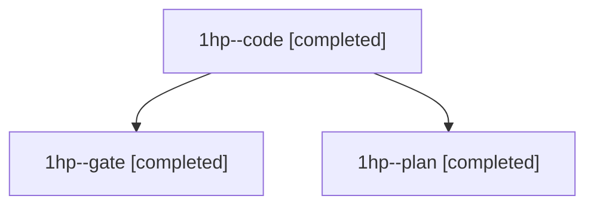

# Session: 1hp

[Agent Hoods](../README.md) / [bbugyi200](../users/bbugyi200/README.md) / [athena](../users/bbugyi200/machines/athena/README.md) / [1hp](../users/bbugyi200/machines/athena/hoods/1hp/README.md) / 1hp

Owner: `bbugyi200.athena` · Hood: `1hp` · Members: 3

## Lineage

The diagram is an optional enhancement; the ordered table below contains the same lineage in accessible text.

| Role | Agent | State | Model / provider | Timing | Commits | Prompt | Chat |
|---|---|---|---|---|---:|---|---|
| code | 1hp--code | completed | grok-4.6 / grok | 2026-11-28T13:23:00.857663+00:00 → 2026-11-28T13:39:58.935451+00:00 | 0 | [Prompt](../agents/bbugyi200.athena.1hp--code/prompt.md) | [Chat](../agents/bbugyi200.athena.1hp--code/chat.md) |
| gate | 1hp--gate | completed | opus / claude | 2026-11-28T13:22:22.365574+00:00 → 2026-11-28T13:22:46.550584+00:00 | 0 | — | [Chat](../agents/bbugyi200.athena.1hp--gate/chat.md) |
| plan | 1hp--plan | completed | opus / claude | 2026-11-28T13:12:10.004400+00:00 → 2026-11-28T13:21:42.382475+00:00 | 0 | [Prompt](../agents/bbugyi200.athena.1hp--plan/prompt.md) | [Chat](../agents/bbugyi200.athena.1hp--plan/chat.md) |
