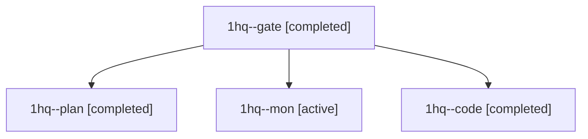

# Session: 1hq

[Agent Hoods](../README.md) / [bbugyi200](../users/bbugyi200/README.md) / [athena](../users/bbugyi200/machines/athena/README.md) / [1hq](../users/bbugyi200/machines/athena/hoods/1hq/README.md) / 1hq

Owner: `bbugyi200.athena` · Hood: `1hq` · Members: 4

## Lineage

The diagram is an optional enhancement; the ordered table below contains the same lineage in accessible text.

| Role | Agent | State | Model / provider | Timing | Commits | Prompt | Chat |
|---|---|---|---|---|---:|---|---|
| gate | 1hq--gate | completed | opus / claude | 2026-11-28T13:29:46.347612+00:00 → 2026-11-28T13:30:44.617534+00:00 | 0 | — | [Chat](../agents/bbugyi200.athena.1hq--gate/chat.md) |
| plan | 1hq--plan | completed | opus / claude | 2026-11-28T13:13:29.479931+00:00 → 2026-11-28T13:29:08.759596+00:00 | 0 | [Prompt](../agents/bbugyi200.athena.1hq--plan/prompt.md) | [Chat](../agents/bbugyi200.athena.1hq--plan/chat.md) |
| mon | 1hq--mon | active | gpt-6-luna / codex | 2026-11-28T14:13:31.896525+00:00 | 0 | — | — |
| code | 1hq--code | completed | gpt-6-luna / codex | 2026-11-28T13:31:12.819461+00:00 → 2026-11-28T14:14:53.237550+00:00 | [1](../agents/bbugyi200.athena.1hq--code/README.md#commits) | [Prompt](../agents/bbugyi200.athena.1hq--code/prompt.md) | [Chat](../agents/bbugyi200.athena.1hq--code/chat.md) |

## Commits

| Role | Repo | Commit | Subject | Committed |
|---|---|---|---|---|
| code | bob-cli | [`0aa33a4`](https://github.com/bobs-org/bob-cli/commit/0aa33a49d171db0aa49263b2d06c41e098a920fe) | feat(merge): create task requirements when merging sources into tasks | 2026-11-28 09:14:36 EST |
