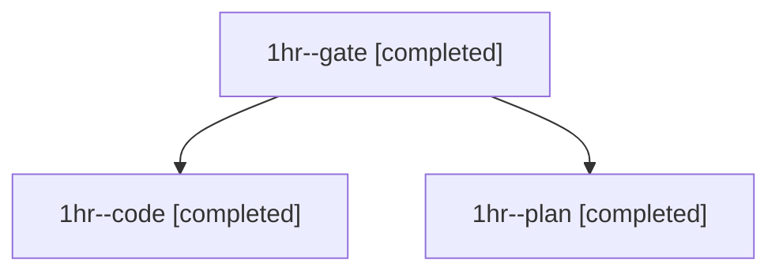

# Session: 1hr

[Agent Hoods](../README.md) / [bbugyi200](../users/bbugyi200/README.md) / [athena](../users/bbugyi200/machines/athena/README.md) / [1hr](../users/bbugyi200/machines/athena/hoods/1hr/README.md) / 1hr

Owner: `bbugyi200.athena` · Hood: `1hr` · Members: 3

## Lineage

The diagram is an optional enhancement; the ordered table below contains the same lineage in accessible text.

| Role | Agent | State | Model / provider | Timing | Commits | Prompt | Chat |
|---|---|---|---|---|---:|---|---|
| gate | 1hr--gate | completed | opus / claude | 2026-11-28T13:34:02.849416+00:00 → 2026-11-28T13:34:27.865489+00:00 | 0 | — | [Chat](../agents/bbugyi200.athena.1hr--gate/chat.md) |
| code | 1hr--code | completed | grok-4.6 / grok | 2026-11-28T13:34:51.579238+00:00 → 2026-11-28T13:58:36.078549+00:00 | [1](../agents/bbugyi200.athena.1hr--code/README.md#commits) | [Prompt](../agents/bbugyi200.athena.1hr--code/prompt.md) | [Chat](../agents/bbugyi200.athena.1hr--code/chat.md) |
| plan | 1hr--plan | completed | opus / claude | 2026-11-28T13:19:48.151229+00:00 → 2026-11-28T13:32:15.631968+00:00 | 0 | [Prompt](../agents/bbugyi200.athena.1hr--plan/prompt.md) | [Chat](../agents/bbugyi200.athena.1hr--plan/chat.md) |

## Commits

| Role | Repo | Commit | Subject | Committed |
|---|---|---|---|---|
| code | bob-cli | [`f561ebd`](https://github.com/bobs-org/bob-cli/commit/f561ebd002e7257232e8654c63f9770f1b6bc3b3) | docs: document headline o as a new req with first-req scoop | 2026-11-28 08:58:09 EST |
