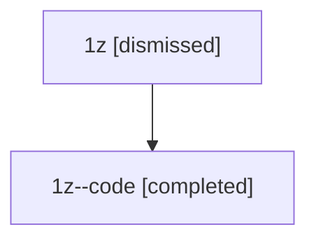

# Session: 1z

[Agent Hoods](../README.md) / [bbugyi200](../users/bbugyi200/README.md) / [athena](../users/bbugyi200/machines/athena/README.md) / [1z](../users/bbugyi200/machines/athena/hoods/1z/README.md) / 1z

Owner: `bbugyi200.athena` · Hood: `1z` · Members: 2

## Lineage

The diagram is an optional enhancement; the ordered table below contains the same lineage in accessible text.

| Role | Agent | State | Model / provider | Timing | Commits | Prompt | Chat |
|---|---|---|---|---|---:|---|---|
| root | 1z | dismissed | opus / claude | 2026-07-08T12:24:28.569465 → 2026-07-08T12:47:14.103042 | [1](../agents/bbugyi200.athena.1z/README.md#commits) | [Prompt](../agents/bbugyi200.athena.1z/prompt.md) | [Chat](../agents/bbugyi200.athena.1z/chat.md) |
| code | 1z--code | completed | gpt-5.5 / codex | 2026-07-08T16:38:06.802453+00:00 | 0 | — | [Chat](../agents/bbugyi200.athena.1z--code/chat.md) |

## Commits

| Role | Repo | Commit | Subject | Committed |
|---|---|---|---|---|
| — | — | `fcd788f` | chore: Add SDD prompt and plan for refs\_base\_view | 2026-06-03 20:57:51 EDT |
| root | — | `e0eb0d4` | chore: Add SDD prompt and plan for option\_bracket\_transcluded\_task\_cycle | 2026-07-08 12:38:04 EDT |
| — | — | `32bfdc2` | chore: Mark SDD plan done | 2026-07-08 12:55:42 EDT |
