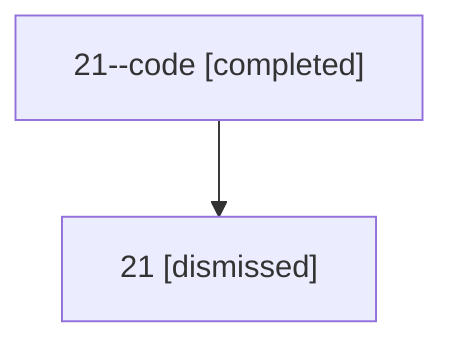

# Session: 21

[Agent Hoods](../README.md) / [bbugyi200](../users/bbugyi200/README.md) / [athena](../users/bbugyi200/machines/athena/README.md) / [21](../users/bbugyi200/machines/athena/hoods/21/README.md) / 21

Owner: `bbugyi200.athena` · Hood: `21` · Members: 2

## Lineage

The diagram is an optional enhancement; the ordered table below contains the same lineage in accessible text.

| Role | Agent | State | Model / provider | Timing | Commits | Prompt | Chat |
|---|---|---|---|---|---:|---|---|
| code | 21--code | completed | gpt-5.5 / codex | 2026-07-08T16:48:30.797106+00:00 | [1](../agents/bbugyi200.athena.21--code/README.md#commits) | — | [Chat](../agents/bbugyi200.athena.21--code/chat.md) |
| root | 21 | dismissed | opus / claude | 2026-07-08T12:32:22.801421 → 2026-07-08T12:55:37.561529 | [1](../agents/bbugyi200.athena.21/README.md#commits) | [Prompt](../agents/bbugyi200.athena.21/prompt.md) | [Chat](../agents/bbugyi200.athena.21/chat.md) |

## Commits

| Role | Repo | Commit | Subject | Committed |
|---|---|---|---|---|
| — | — | `248eee6` | chore: Add SDD prompt and plan for obsidian\_transclusion\_toggle\_keymap | 2026-06-03 22:02:19 EDT |
| root | — | `59eca4d` | chore: Add SDD prompt and plan for replace\_blocked\_with\_next\_task\_status | 2026-07-08 12:48:29 EDT |
| code | — | `27ea107` | chore: update project task status examples | 2026-07-08 12:54:59 EDT |

## Neighbors

| Agent | Relation | State |
|---|---|---|
| [21.f1](bbugyi200.athena.21.f1.md) (session · 2) | descendant | completed 1, dismissed 1 |
| [21.f2](bbugyi200.athena.21.f2.md) (session · 2) | descendant | completed 1, dismissed 1 |
